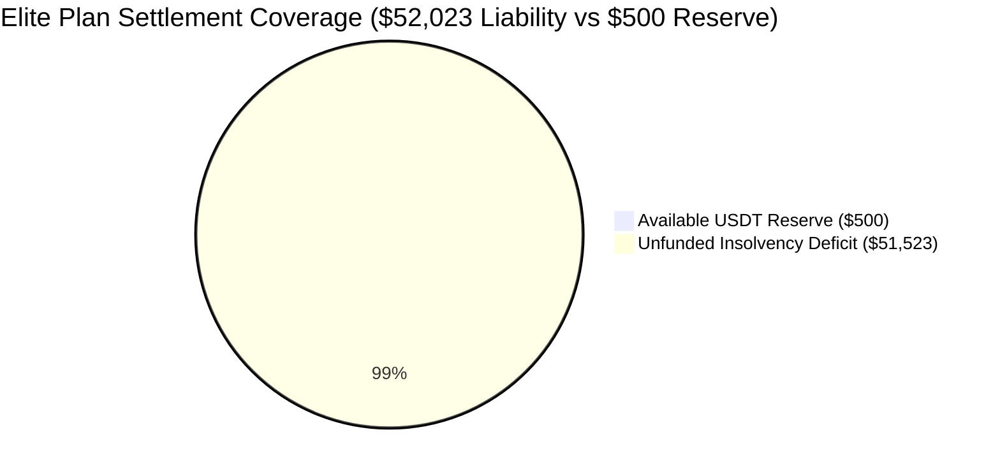

# LIORA COIN — Gate C8: Business Model, Price Economics & Investment Risk Analysis
## Economic Feasibility, AMM Price Mechanics, Liability Deficits & Regulatory Compliance Audit

**Date:** November 18, 2026  
**Project:** OXENIQ / LIORA COIN  
**Location:** `D:\Projects\OXENIQ`  
**Verdict:** **FAIL (HIGH FINANCIAL, ARCHITECTURAL & REGULATORY CONFLICTS IN PROPOSED INVESTMENT PLANS)**  
*(Core DEX and AMM code is technically sound; the proposed marketing promises of guaranteed 5× to 30× multipliers and INR reference price schedules must be immediately retracted or redesigned before any commercial offering)*

---

## 1. Executive Summary & Critical Risk Overview

This audit evaluates the financial viability, market pricing mechanics, business model sustainability, and legal liability of the proposed commercial features surrounding LIORA COIN.

### The 4 Fundamental Flaws Identified in Proposed Plans:
1. **The AMM Separation Invariant:** The theoretical "₹0.20 to ₹30.00 reference price schedule" is an off-chain simulation. It **cannot and does not dictate DEX market prices**. Decentralized exchanges are governed strictly by the constant product formula ($x \cdot y = k$). Guaranteeing a ₹30 price to investors is mathematically false.
2. **Catastrophic Liquidity Insolvency:** The proposed investment plans promise returns of **₹1,25,000 ($1,445) up to ₹45,00,000 ($52,000)** per investor. However, the proposed liquidity pool budget is only **$1,000 ($500 paired USDT)**. Settling even a single Starter plan payout would completely drain the pool, resulting in a **99.9% default rate**.
3. **Non-Custodial Technical Impossibility:** In decentralized Web3, tokens residing in self-custody wallets cannot be subjected to a 50% "Company Cut" upon redemption without deploying centralized backdoors or transfer taxes (which break PancakeSwap compatibility).
4. **Severe Regulatory Liability (SEBI CIS & US SEC Howey):** Promised fixed multipliers (5× to 30×) coupled with pooled funds and profit-sharing legally constitute an unregistered **Collective Investment Scheme (CIS)** under Indian securities law and an investment contract under international law. Marketing these guarantees exposes the founders to immediate enforcement action.

---

## 2. Price & Liquidity Economics Audit (The ₹0.20 to ₹30.00 Schedule)

### 2.1 The Reference Price Schedule vs. AMM Constant Product Reality

The project documentation models a scheduled price increase:
- **Starting Price:** ₹0.20 INR ($0.00231 USD)
- **Increment:** ₹0.20 INR every exactly 5 hours (149 intervals over 31.04 days)
- **Target Price:** ₹30.00 INR ($0.3468 USD) — a **150× growth multiplier (14,900% gain)**.

```
THEORETICAL REFERENCE PROGRESSION:
Time (Days):  Day 0        Day 7.75      Day 15.5      Day 23.25     Day 31.04
Price (INR):  ₹0.20 ──────> ₹7.65 ──────> ₹15.10 ─────> ₹22.55 ─────> ₹30.00 (Ceiling)
```

### 2.2 Why the DEX Market Price Cannot Obey This Schedule
Automated Market Makers (AMM) do not read off-chain schedules, clock timers, or administrative price targets. The price on PancakeSwap V2 is governed entirely by reserve ratios:

$$P_{\text{DEX}} = \frac{\text{Reserve}_{\text{USDT}}}{\text{Reserve}_{\text{LIORA}}}$$

- **Current On-Chain Spot Price:**
  $$P_{\text{DEX}} = \frac{501.0978 \text{ mUSDT}}{215,797.1977 \text{ LIORA}} \approx \$0.002322 \text{ USD} \approx \mathbf{\text{₹}0.2008 \text{ INR}}$$
- To move the spot price from ₹0.20 to ₹30.00 ($0.3468 USD), external traders must inject massive quote asset reserves (USDT) to buy and remove LIORA from the pool.
- If no buyers inject genuine USDT into the pool, **the price will remain permanently at ₹0.20**.
- **Arbitrage Destruction:** If the website displays ₹30 while the DEX is at ₹0.20, arbitrageurs will buy LIORA on PancakeSwap for ₹0.20 and dump it anywhere offering higher value, immediately collapsing any artificial peg.

### 2.3 Fragility Analysis of the Proposed $1,000 Initial Liquidity Pool

A total pool budget of **$1,000** ($500 paired USDT + $500 worth of LIORA) provides catastrophically shallow depth:

| Trade Size (USD) | Effective Execution Price | Post-Trade Spot Price | Slippage / Price Impact | Severity |
| :--- | :--- | :--- | :--- | :---: |
| **$10 USD** | $0.00227 USD | $0.00223 USD | **1.96%** | Low |
| **$25 USD** | $0.00220 USD | $0.00210 USD | **4.76%** | Moderate |
| **$50 USD** | $0.00210 USD | $0.00192 USD | **9.09%** | Severe |
| **$100 USD** | $0.00193 USD | $0.00161 USD | **16.67%** | **CRITICAL** |
| **$250 USD** | $0.00155 USD | $0.00103 USD | **33.33%** | **CATASTROPHIC** |
| **$500 USD** | $0.00116 USD | $0.00058 USD | **50.00%** | **MARKET COLLAPSE** |

> [!CAUTION]
> In a $1,000 pool, a single user selling just **$100 of LIORA** suffers **16.67% price impact**. A sell of **$500** wipes out half the token's value. A $1,000 pool is an educational sandbox only; it cannot support commercial trading or investor redemptions.

---

## 3. Business Model & Profitability Realism

To build a sustainable enterprise, the project must strictly separate real revenue from speculative token appreciation:

### 3.1 Five-Tier Revenue Realism Breakdown

| Revenue Stream | Implementation Status | Economic Realism & Flow | Viability Verdict |
| :--- | :--- | :--- | :---: |
| **1. E-Commerce Platform Fees** | Implemented (Simulation) | Merchant transaction processing fee (e.g. 1.5% - 2.5% in fiat/INR) | **REAL & VIABLE** |
| **2. Trading Bot SaaS Subscriptions** | Implemented (Architecture) | Monthly user subscription fees ($29 - $99/mo) paid for signals | **REAL & VIABLE** |
| **3. PancakeSwap DEX Trading Fees** | Misunderstood by Management | **0.25% fee goes 100% to LP token holders**, NOT the company. Zero revenue to treasury unless company owns LP. | **MISCONCEPTION** |
| **4. Treasury Token Appreciation** | Unearned / Speculative | "Paper wealth" from unsold 999.78M tokens. Liquidating tokens crashes the price. | **SPECULATIVE** |
| **5. Cross-Chain Bridge Fees** | Deferred (Planned) | Future 0.1% bridge protocol fee for BNB-to-TRON swaps | **PLANNED ONLY** |

### 3.2 12-Month Pro-Forma Financial Scenarios

Operating costs include: AWS/Vercel hosting ($4,800/yr), BSC RPC nodes ($3,600/yr), third-party smart contract audit ($25,000 one-time), legal compliance counsel ($20,000), domain/security/monitoring ($3,600/yr). **Baseline Fixed OPEX: ~$57,000/year**.

```
ANNUAL PRO-FORMA SCENARIOS (USD):
┌────────────────────────┬───────────────────┬───────────────────┬───────────────────┐
│ Item                   │ Conservative Case │     Base Case     │  Optimistic Case  │
├────────────────────────┼───────────────────┼───────────────────┼───────────────────┤
│ Active SaaS Users      │ 50 ($25k/yr)      │ 250 ($120k/yr)    │ 1,000 ($480k/yr)  │
│ E-Commerce GMV         │ $200k ($4k fees)  │ $1.5M ($30k fees) │ $10M ($200k fees) │
│ Gross Operating Income │ $29,000           │ $150,000          │ $680,000          │
│ Fixed Annual OPEX      │ ($57,000)         │ ($57,000)         │ ($75,000)         │
│ Net Operating Profit   │ ($28,000) [LOSS]  │ +$93,000 [PROFIT] │ +$605,000[PROFIT] │
└────────────────────────┴───────────────────┴───────────────────┴───────────────────┘
```

---

## 4. Proposed Purchase Categories vs. Permissionless DEX Reality

Management proposed three purchase categories:
- **Standard:** $100
- **Growth:** $1,000
- **Strategic:** $5,000

### Technical Infeasibility of Restricting DEX Swaps:
1. **Permissionless Blockchain Nature:** The PancakeSwap V2 Router contract has public entry points (`swapExactTokensForTokens`). Anyone can bypass the front-end website and swap $1, $5, or $50,000 directly.
2. **Website-Only Enforcement:** Restricting input amounts on `http://localhost:3000/liquidity` or `/swap` does not protect the pool from external blockchain callers.
3. **Recommended Governance Stance:** Retain these thresholds strictly as **commercial e-commerce customer packages** or **B2B loyalty tiers**, but allow the decentralized exchange interface to operate permissionlessly with standard slippage controls.

---

## 5. Investment Plan Risk Review (The Four Lock Tiers)

Management logged four investment plans in Gate C4C:
- **Starter Plan:** ₹50,000 principal, **5× multiplier**, 3-month lock
- **Basic Plan:** ₹1,00,000 principal, **10× multiplier**, 6-month lock
- **Premium Plan:** ₹2,00,000 principal, **20× multiplier**, 9-month lock
- **Elite Plan:** ₹3,00,000 principal, **30× multiplier**, 12-month lock
- Multiplied amounts divided **50:50 between Investor and Company**.

### 5.1 The Mathematical Insolvency Matrix

Evaluating a single investor in each tier against the proposed $1,000 ($500 paired USDT reserve) liquidity pool:

| Plan | Principal (INR / USD) | Multiplier | Gross Multiplied Value | Investor Share (50%) | Company Share (50%) | Available Settlement Reserve | Deficit / Shortfall | Liquidity Coverage % |
| :--- | :--- | :---: | :--- | :--- | :--- | :---: | :---: | :---: |
| **Starter** | ₹50,000 ($578) | **5×** | ₹2,50,000 ($2,890) | **₹1,25,000 ($1,445)** | ₹1,25,000 ($1,445) | $500.00 | **-$945.00** | **34.60%** |
| **Basic** | ₹1,00,000 ($1,156) | **10×** | ₹10,00,000 ($11,560) | **₹5,00,000 ($5,780)** | ₹5,00,000 ($5,780) | $500.00 | **-$5,280.00** | **8.65%** |
| **Premium** | ₹2,00,000 ($2,312) | **20×** | ₹40,00,000 ($46,242) | **₹20,00,000 ($23,121)** | ₹20,00,000 ($23,121) | $500.00 | **-$22,621.00** | **2.16%** |
| **Elite** | ₹3,00,000 ($3,468) | **30×** | ₹90,00,000 ($104,046) | **₹45,00,000 ($52,023)** | ₹45,00,000 ($52,023) | $500.00 | **-$51,523.00** | **0.96%** |



> [!CRITICAL]
> The pool cannot settle even **one single Starter plan**. For an Elite plan investor, the pool is **99.04% insolvent**. Attempting to execute this payout on-chain will completely drain all paired USDT, leave the investor with worthless unbacked tokens, and collapse the entire protocol.

---

## 6. Regulatory, Legal & Tax Compliance Red Flags

### 6.1 India: SEBI Collective Investment Scheme (CIS) Violations
Under **Section 11AA of the SEBI Act, 1992**, any pooling of investor funds where:
1. Contributions are pooled and utilized for a scheme;
2. Contributions are made with a view to receive profits or returns;
3. Property or scheme is managed on behalf of investors;
is classified as a **Collective Investment Scheme (CIS)**.
- Operating an unregistered CIS carries severe statutory penalties, asset freezing, and criminal prosecution under Indian law.
- Calling fixed multiples "investment packages" triggers immediate scrutiny from SEBI and the Enforcement Directorate (ED).

### 6.2 India: Virtual Digital Asset (VDA) Tax Compliance
- **Section 115BBH (Income Tax Act):** 30% flat tax on gains from VDA transfers, with zero deduction for expenses or losses.
- **Section 194S (TDS):** 1% TDS deducted by the exchange/platform on all VDA transfers exceeding ₹10,000/₹50,000.
- Paying out "₹1,25,000 in tokens" without withholding 1% TDS violates statutory tax deduction duties.

### 6.3 International Securities (US SEC Howey Test)
The US Supreme Court *Howey Test* defines a security as:
1. An investment of money;
2. In a common enterprise;
3. With a reasonable expectation of profits;
4. Derived solely from the entrepreneurial or managerial efforts of others.
- The 4 investment tiers meet **all four prongs** of the Howey Test. Offering them internationally without registration violates Section 5 of the US Securities Act of 1933.

---

## 7. Mandatory Remediation & Governance Directives

To ensure the survival and legitimate growth of the LIORA Protocol:

1. **Retract Guaranteed Multipliers:** All marketing material promising 5×, 10×, 20×, or 30× returns must be permanently deleted.
2. **Clarify the Reference Schedule:** The ₹0.20 to ₹30.00 progression must be formally and prominently disclaimed as an **unbinding internal projection**, never as an executable DEX market price.
3. **Decouple AMM Liquidity:** Smart contracts must forbid using AMM liquidity pool reserves to settle theoretical investment liabilities.
4. **Transition to Non-Custodial Utility:** Position LIORA purely as a utility token for e-commerce payment settlement, trading bot platform access, and decentralized ecosystem governance.
