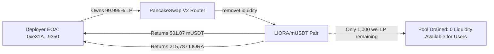

# LIORA COIN — Gate C8: Tokenomics & LP Custody Review
## On-Chain Supply Distribution, Liquidity Custody & Economic Fragility Assessment

**Date:** November 18, 2026  
**Project Root:** `D:\Projects\OXENIQ`  
**Network Analyzed:** BNB Smart Chain Testnet (Chain ID `97`)  
**PancakeSwap V2 Pair:** `0x64beE3847a766D35E6611985F3c3e51C78Af5D2c`  
**Deployment Wallet:** `0xe31A2ec1474DfA2F5316dA0033f3Bd57F9D19350`  
**Test Wallet:** `0xf28D702684cA539cCeBd69ba8be30d35d9ca12aD`  
**Verdict:** **CONDITIONAL PASS** (Valid mathematical token mechanics; Critical operational requirement to implement on-chain vesting and certified LP timelock before mainnet launch)

---

## 1. Executive Summary & Verification Findings

This audit evaluates the macroeconomic structure of LIORA COIN, reconciling proposed business model tokenomics against verified on-chain blockchain records. 

### Core Verdict & Findings:
1. **Total Supply Confirmed:** The total supply is strictly fixed at **1,000,000,000 LIORA** with 18 decimal places. Arbitrary post-deployment minting is physically impossible in the smart contract.
2. **70:30 Allocation is Proposed, Not Implemented:** The proposed 70% ecosystem / 30% liquidity reserve distribution exists only in specification documents. On-chain, **99.978% of all tokens reside in a single deployer EOA**.
3. **Liquidity is 100% Unlocked:** The deployer EOA owns **99.9953% of all Cake-LP tokens**. The liquidity pool is completely unlocked, exposing all liquidity providers to single-key withdrawal (rug-pull) risk until a certified timelock contract is deployed.
4. **Circulating Supply is 0.0216%:** True circulating supply is approximately **215,849 LIORA**. Reporting treasury tokens as circulating market cap is economically invalid.

---

## 2. On-Chain Token Distribution Audit

### 2.1 Actual vs. Proposed Allocation Breakdown

```
PROPOSED TOKENOMICS ALLOCATION:
┌────────────────────────────────────────────────────────┐
│ 70% Ecosystem & Community Treasury (700,000,000 LIORA) │
│ 30% Protocol Liquidity Reserve     (300,000,000 LIORA) │
└────────────────────────────────────────────────────────┘

ACTUAL LIVE ON-CHAIN ALLOCATION (BSC Testnet #97):
┌──────────────────────────────────────────────────────────────────────────┐
│ Deployer EOA (0xe31A...9350): 999,784,150.81 LIORA (99.9784%)            │
│ PancakeSwap V2 Pool:             215,797.20 LIORA ( 0.0216%)            │
│ Test Wallet (0xf28D...12aD):          51.99 LIORA ( 0.000005%)          │
└──────────────────────────────────────────────────────────────────────────┘
```

### 2.2 Verified Holder Ledger

| Entity / Address | Classification | Balance (LIORA) | Raw Balance (wei) | Supply Share |
| :--- | :--- | :--- | :--- | :---: |
| **Deployer EOA** (`0xe31A...9350`) | Single Private Key (EOA) | `999,784,150.8149` | `999784150814934706546936710` | **99.9784%** |
| **PancakeSwap V2 Pair** (`0x64be...5D2c`) | AMM Liquidity Pool | `215,797.1977` | `215797197732343641939611` | **0.0216%** |
| **Test Wallet** (`0xf28D...12aD`) | MetaMask Retail Test Wallet | `51.9873` | `51987332949811123679` | **0.000005%** |
| **Total Mined & Tracked** | — | **`1,000,000,000.0000`** | `1000000000000000000000000000` | **100.0000%** |

### 2.3 Critical Finding: Zero Programmatic Vesting
- There are **no smart contract vesting schedules**, timelocks, or multi-signature safeguards currently holding the 999.78M treasury tokens.
- **Selling Pressure Risk:** If the private key of `0xe31A...9350` is compromised, an attacker could transfer any quantity of the 999.78M tokens into the PancakeSwap pool, crashing the price to near zero and draining the entire paired USDT reserve in a single block.

---

## 3. PancakeSwap V2 LP Custody & Liquidity Risk Audit

### 3.1 Live Pool Metrics (PancakeSwap V2 Pair: `0x64beE3847a766D35E6611985F3c3e51C78Af5D2c`)
- **Factory:** `0x6725F303b657a9451d8BA641348b6761A6CC7a17` (Verified official PancakeSwap V2 Testnet Factory)
- **Router:** `0xD99D1c33F9fC3444f8101754aBC46c52416550D1` (Verified official PancakeSwap V2 Testnet Router)
- **Token 0:** `0x0b419a33e8a6448547906DCB191b037Db5ac926e` (Mock USDT)
- **Token 1:** `0xeD155E37D0a400E63202cE031Fc1C984B18E7999` (LIORA COIN)
- **Reserve 0 (mUSDT):** `501.097830175789374225 mUSDT`
- **Reserve 1 (LIORA):** `215,797.197732343641939611 LIORA`
- **Total LP Supply:** `10,398.804890209343669682 Cake-LP` (`10398804890209343669682 wei`)

### 3.2 LP Ownership Breakdown

| LP Holder | Cake-LP Balance | Raw Balance (wei) | Pool Ownership % | Status |
| :--- | :--- | :--- | :---: | :--- |
| **Deployer EOA** (`0xe31A...9350`) | `10,398.317171` | `10398317171542710736376` | **99.9953%** | **UNLOCKED (EOA Custody)** |
| **Test Wallet** (`0xf28D...12aD`) | `0.481878` | `481878587835377285` | **0.0046%** | Non-Custodial User |
| **Zero Address** (`address(0)`) | `0.000000000000001` | `1000` | **0.00000001%** | **Permanently Locked (Protocol)** |
| **Total LP Tokens** | **`10,398.804890`** | `10398804890209343669682` | **100.0000%** | — |

### 3.3 Assessment of Unlocked Liquidity & Rug-Pull Consequences



1. **Vulnerability:** The deployment wallet can invoke `removeLiquidity` on the router at any time without delay or multi-sig approval.
2. **Consequences:**
   - Drains **501.07 mUSDT** (99.995% of paired quote capital).
   - Drains **215,787 LIORA**.
   - The remaining user (`0.4818 Cake-LP`) is left with unbacked pool units worth fractions of a cent.
   - All subsequent swap transactions fail with `PancakeRouter: INSUFFICIENT_LIQUIDITY`.
3. **Verdict:** For testnet development, this architecture is acceptable for rapid iteration; for production mainnet, **this is an unacceptable, fatal centralization flaw**.

---

## 4. Circulating Supply vs. Market Capitalization Audit

A common pitfall in early-stage Web3 projects is calculating fully diluted valuation (FDV) and conflating it with active circulating market capitalization.

### Mathematical Proof of Circulating Reality:
- **Max / Total Supply ($S_{\text{total}}$):** 1,000,000,000 LIORA
- **Treasury Reserve Held by Deployer ($S_{\text{treasury}}$):** 999,784,151 LIORA
- **True Circulating Supply ($S_{\text{circ}} = S_{\text{total}} - S_{\text{treasury}}$):** **215,849 LIORA**
- **Current DEX Spot Price ($P_{\text{DEX}}$):** $\$0.002322 \text{ USD}$ (₹0.2008 INR)

$$\text{True Circulating Market Cap} = S_{\text{circ}} \times P_{\text{DEX}} = 215,849 \times \$0.002322 = \mathbf{\$501.20 \text{ USD}}$$

$$\text{Fully Diluted Valuation (Hypothetical)} = S_{\text{total}} \times P_{\text{DEX}} = 1,000,000,000 \times \$0.002322 = \mathbf{\$2,322,000.00 \text{ USD}}$$

> [!WARNING]
> Presenting the Fully Diluted Valuation ($2.32M) as the active market capitalization to retail users or exchanges is considered deceptive under international financial reporting standards. Only the active circulating supply ($501.20) is supported by liquidity.

---

## 5. Required Liquidity Governance & Custody Policy

Before initiating any mainnet deployment, management must formally adopt and execute the following governance policy:

1. **Deployer Role Retirement:**
   - The single deployment EOA must be retired immediately following contract deployment.
   - Ownership of `LioraToken.sol` must be transferred via `transferOwnership()` to a **Gnosis Safe (3-of-5 threshold)**.
2. **Mandatory Third-Party LP Lock:**
   - 100% of newly minted LP tokens on BSC Mainnet must be deposited into a recognized third-party smart contract locker:
     - **UNCX Network (formerly UniCrypt)** or **PinkLock (PinkSale)**.
   - **Minimum Lock Duration:** **24 to 36 calendar months**.
   - Lock contracts must be configured with no emergency unlock functions or single-admin backdoors.
3. **Ecosystem & Treasury Vesting Schedule:**
   - The 700,000,000 ecosystem tokens must be transferred into an immutable OpenZeppelin `VestingWallet` contract.
   - **Vesting Terms:** 6-month cliff followed by 24-month linear per-second block release.
   - Eliminates dump risks and provides proof of long-term alignment to investors.
4. **Liquidity Depth Target:**
   - As documented in DEC-05, a shallow $1,000 pool cannot support commercial operations. The project must provision at least **$100,000 to $500,000 in genuine USDT paired quote capital** at Genesis launch to provide adequate slippage resistance.
