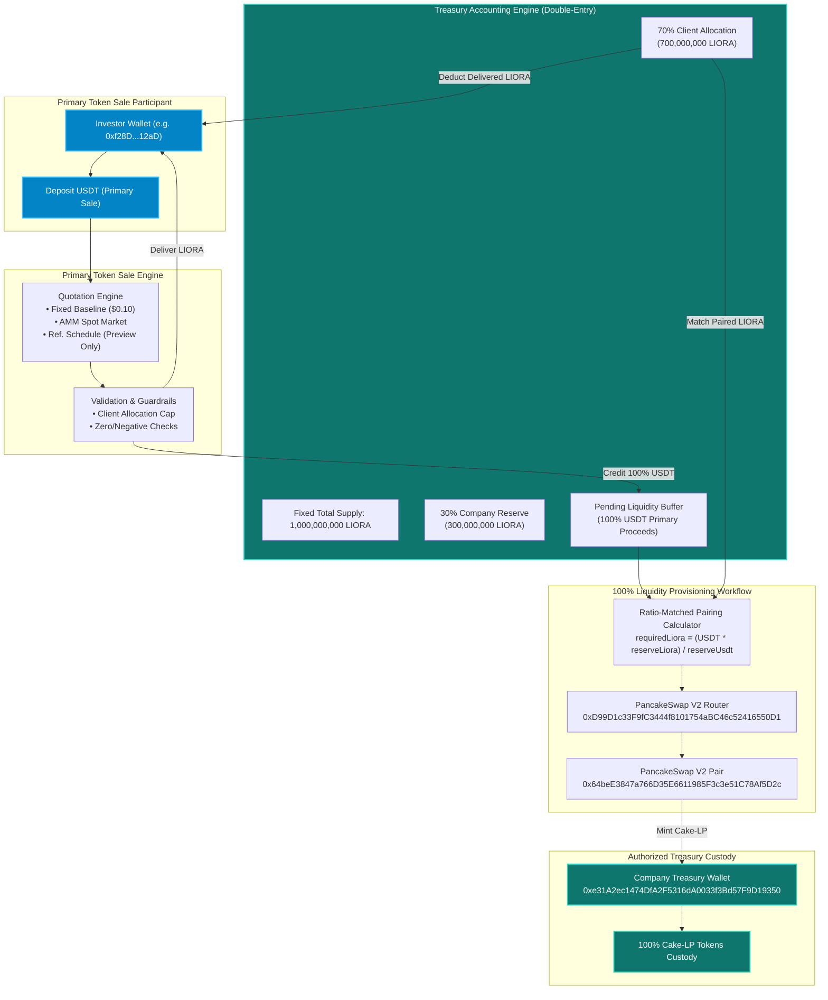

# LIORA COIN — Gate C9 Architecture Specification
## Primary Token Sale, Treasury Architecture & Liquidity Accounting

**Project Root:** `D:\Projects\OXENIQ`  
**Network:** BNB Smart Chain Testnet (Chain ID: `97`)  
**Status:** Gate C9 Implemented & Verified  
**Date:** November 2026  

---

## 1. Executive Summary

Gate C9 introduces the core architectural pillars for LIORA's primary capital formation, treasury asset accounting, and automated liquidity provisioning on BSC Testnet. Following the security and tokenomics conclusions established in Gate C8, this release guarantees that **100% of all USDT proceeds received from primary investor token sales are channeled directly and exclusively into LIORA/USDT protocol liquidity**, with all resulting PancakeSwap V2 LP tokens owned by the company treasury.

---

## 2. Fundamental Architectural Invariants

### 2.1 Fixed Supply & 70:30 Bucket Separation Invariant
The total supply of LIORA is immutable and hardcoded at exactly **1,000,000,000 LIORA** ($10^{27}$ base units):
$$\text{TotalSupply} \equiv \text{ClientAllocation}_{\text{total}} + \text{CompanyReserve}_{\text{total}} \equiv 1,000,000,000 \text{ LIORA}$$
- **Client Allocation (70%):** Exactly 700,000,000 LIORA ($7 \times 10^{26}$ wei) allocated exclusively for client primary sales, rewards, and paired protocol liquidity.
- **Company Emergency/Crisis Reserve (30%):** Exactly 300,000,000 LIORA ($3 \times 10^{26}$ wei) held strictly offline/isolated for corporate crisis mitigation. Paired liquidity draws are mathematically prohibited from touching this reserve.

### 2.2 Mathematical Balance Conservation
Across all ledger operations, the double-entry accounting engine enforces:
$$\text{DeliveredToBuyers} + \text{PairedInLiquidity} + \text{CommittedPending} + \text{AvailableClient} + \text{CompanyReserve} \equiv 1,000,000,000 \text{ LIORA}$$

### 2.3 100% Proceeds-to-Liquidity Routing
Every single cent of primary token-sale proceeds (USDT) is accounted for in the liquidity provisioning pipeline:
$$\text{GrossPrimarySaleUSDT} \equiv \text{USDT}_{\text{allocated\_to\_liquidity}} + \text{USDT}_{\text{pending\_liquidity}}$$
Zero USDT from primary sales is diverted to operational expense accounts or speculative trading wallets.

### 2.4 Treasury LP Token Ownership
All PancakeSwap V2 liquidity provider tokens (`Cake-LP`) minted from liquidity provisioning workflows are deposited directly to and owned by the authorized company treasury wallet:
$$\text{LP}_{\text{minted}} \to \text{0xe31A2ec1474DfA2F5316dA0033f3Bd57F9D19350}$$

### 2.5 Market Pricing Decoupling
The internal reference-price schedule (stepping from ₹0.20 to ₹30.00 every 5 hours) is an economic simulation. On-chain decentralized exchange (DEX) pricing fluctuates autonomously according to constant-product automated market maker reserves ($x \cdot y = k$).

---

## 3. Subsystem Architecture

### 3.1 Primary Token Sale Engine
- **Module:** [apps/web/src/lib/sale/primaryTokenSaleEngine.ts](file:///d:/Projects/OXENIQ/apps/web/src/lib/sale/primaryTokenSaleEngine.ts)
- **Role:** Handles quote generation, pricing model selection, client allocation validation, and purchase execution simulation.
- **Supported Pricing Models:**
  1. `FIXED_BASELINE`: Stable pre-sale benchmark tier at $0.10 USD (₹8.65 INR).
  2. `DEX_SPOT_MARKET`: Dynamic market spot rate derived from PancakeSwap V2 pool reserves.
  3. `REFERENCE_SCHEDULE`: Theoretical simulation model. Executions under this model are blocked and flagged with explicit warnings because management pricing approval is pending.
- **Safety Limits:** Minimum deposit bounds (> 0 USDT), maximum allocation check (cannot exceed available 70% bucket), 18-decimal integer precision avoiding IEEE-754 float rounding errors.

### 3.2 Treasury Accounting Engine
- **Module:** [apps/web/src/lib/treasury/treasuryAccountingEngine.ts](file:///d:/Projects/OXENIQ/apps/web/src/lib/treasury/treasuryAccountingEngine.ts)
- **Role:** State machine managing treasury balances, tracking double-entry sub-accounts, and running continuous integrity audits.
- **5-Point Reconciliation:**
  1. Total LIORA supply matches 1,000,000,000 LIORA.
  2. Client sub-accounts sum to exactly 700,000,000 LIORA.
  3. Company reserve sub-accounts sum to exactly 300,000,000 LIORA.
  4. 100% of primary sale USDT matches allocated plus pending liquidity USDT.
  5. Treasury LP token balance equals recorded provision receipts.

### 3.3 Liquidity Provisioning Workflow
- **Module:** [apps/web/src/lib/treasury/liquidityProvisioningWorkflow.ts](file:///d:/Projects/OXENIQ/apps/web/src/lib/treasury/liquidityProvisioningWorkflow.ts)
- **Role:** Plans and executes batch liquidity additions to PancakeSwap V2 using accumulated primary sale USDT proceeds.
- **Pairing Mechanics:**
  $$\text{Required LIORA} = \frac{\text{USDT to Allocate} \times \text{Reserve}_{\text{LIORA}}}{\text{Reserve}_{\text{USDT}}}$$
  Sourced strictly from `availableClientAllocationRaw`.
- **Status Transparency:** Clearly distinguishes between "Pending Liquidity" (USDT collected awaiting batch execution) and "Deposited Pool Liquidity" (on-chain PancakeSwap pair reserves).

### 3.4 Decoupled Dual Price Display Service
- **Module:** [apps/web/src/lib/dex/dualPriceService.ts](file:///d:/Projects/OXENIQ/apps/web/src/lib/dex/dualPriceService.ts)
- **Role:** Computes and surfaces side-by-side pricing metrics showing the theoretical reference price schedule vs. live PancakeSwap V2 AMM spot price, including divergence percentages and non-binding simulation disclaimers.

---

## 4. On-Chain Contracts & Infrastructure

| Contract / Entity | Address | Network | Function |
| :--- | :--- | :--- | :--- |
| **LIORA Token** | `0xeD155E37D0a400E63202cE031Fc1C984B18E7999` | BSC Testnet (97) | Standard BEP-20 fixed supply token |
| **Mock USDT (mUSDT)** | `0x0b419a33e8a6448547906DCB191b037Db5ac926e` | BSC Testnet (97) | Paired quote asset (18 decimals) |
| **PancakeSwap V2 Pair** | `0x64beE3847a766D35E6611985F3c3e51C78Af5D2c` | BSC Testnet (97) | LIORA/mUSDT Constant Product AMM |
| **PancakeSwap V2 Router** | `0xD99D1c33F9fC3444f8101754aBC46c52416550D1` | BSC Testnet (97) | Liquidity & swap execution router |
| **PancakeSwap V2 Factory** | `0x6725F303b657a9451d8BA641348b6761A6CC7a17` | BSC Testnet (97) | Pair factory contract |
| **Authorized Treasury Wallet** | `0xe31A2ec1474DfA2F5316dA0033f3Bd57F9D19350` | BSC Testnet (97) | Company treasury and LP custody wallet |
| **Test Investor Wallet** | `0xf28D702684cA539cCeBd69ba8be30d35d9ca12aD` | BSC Testnet (97) | External user testing wallet |

---

## 5. Security & Isolation Controls

1. **BSC Testnet Enforcement:** Hard-coded guards actively block execution if `chainId !== 97`. BSC Mainnet (Chain ID `56`) remains blocked.
2. **Single Authorized Treasury Authority:** Administrative treasury adjustments and batch liquidity executions can only be signed or initiated by `0xe31A2ec1474DfA2F5316dA0033f3Bd57F9D19350`.
3. **No Key Exposure:** Private keys and mnemonic seed phrases are excluded from client code, local storage, logs, and telemetry.
4. **Anti-Drain Safeguards:** Company emergency reserves (300M LIORA) cannot be spent, paired into AMMs, or drawn by primary sales without manual multi-sig governance approval.
