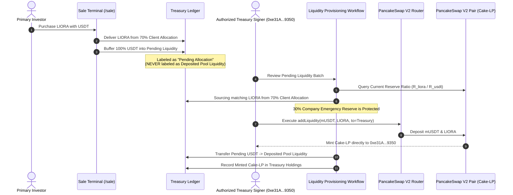

# LIORA COIN — Gate C9 Liquidity Workflow
## 100% Primary Sale Proceeds Provisioning & PancakeSwap V2 Minting

**Project Root:** `D:\Projects\OXENIQ`  
**Network:** BNB Smart Chain Testnet (Chain ID: `97`)  
**PancakeSwap V2 Router:** `0xD99D1c33F9fC3444f8101754aBC46c52416550D1`  
**PancakeSwap V2 Pair:** `0x64beE3847a766D35E6611985F3c3e51C78Af5D2c`  
**Company Treasury Wallet:** `0xe31A2ec1474DfA2F5316dA0033f3Bd57F9D19350`  
**Status:** Implemented & Verified  

---

## 1. Liquidity Lifecycle Architecture

The Gate C9 Liquidity Workflow bridges primary investor demand with secondary decentralized market depth. When investors buy LIORA via the primary token sale, their USDT is not treated as company revenue; it is pooled in a designated buffer to permanently deepen market liquidity.



---

## 2. Dynamic Ratio Matching Formula

Liquidity additions on PancakeSwap V2 require depositing tokens in exact proportion to the prevailing pool reserves to prevent immediate arbitrage slippage:
$$\frac{\Delta \text{LIORA}}{\Delta \text{USDT}} = \frac{\text{Reserve}_{\text{LIORA}}}{\text{Reserve}_{\text{USDT}}}$$

Therefore, for any batched primary sale USDT amount ($\Delta \text{USDT}$):
$$\text{Required LIORA} = \frac{\Delta \text{USDT} \times \text{Reserve}_{\text{LIORA}}}{\text{Reserve}_{\text{USDT}}}$$

### 2.1 Concrete Example (Based on Current Testnet Reserves)
- Current Pool Reserves: $\text{Reserve}_{\text{LIORA}} \approx 215,797.4326$, $\text{Reserve}_{\text{mUSDT}} \approx 500.9769$.
- If a batch has 500.00 USDT pending:
  $$\text{Required LIORA} = \frac{500.00 \times 215,797.4326}{500.9769} \approx 215,376.54 \text{ LIORA}$$
- Expected LP tokens minted:
  $$\Delta \text{LP} = \min\left( \frac{500.00 \times \text{TotalSupply}_{\text{LP}}}{500.9769}, \frac{215,376.54 \times \text{TotalSupply}_{\text{LP}}}{215,797.4326} \right)$$
- Result: 100% of the newly minted LP tokens are credited directly to the company treasury wallet (`0xe31A2ec1474DfA2F5316dA0033f3Bd57F9D19350`).

---

## 3. Strict Sourcing & Separation Controls

1. **Client Allocation Sourcing:** The matching LIORA tokens required for pairing are deducted strictly from `availableClientAllocationRaw` (the 70% bucket).
2. **Emergency Reserve Shield:** The `companyReserveTotalRaw` (300,000,000 LIORA) is hard-locked; the workflow throws an error if any provision attempt requires tokens beyond the available client allocation.
3. **Transparent Reporting Invariant:** Pending primary sale USDT is explicitly categorized as *Pending Liquidity Allocation*. It is never reported to investors as *Active On-Chain Market Liquidity* until the on-chain router transaction is mined and confirmed.
4. **Non-Custodial Destination:** The recipient of minted LP tokens is hardcoded to the authorized company treasury address `0xe31A2ec1474DfA2F5316dA0033f3Bd57F9D19350`.

---

## 4. On-Chain Router Integration

Batch executions utilize the verified PancakeSwap V2 Router interface:
```solidity
function addLiquidity(
    address tokenA,
    address tokenB,
    uint amountADesired,
    uint amountBDesired,
    uint amountAMin,
    uint amountBMin,
    address to,
    uint deadline
) external returns (uint amountA, uint amountB, uint liquidity);
```
- `tokenA`: `0x0b419a33e8a6448547906DCB191b037Db5ac926e` (Mock USDT)
- `tokenB`: `0xeD155E37D0a400E63202cE031Fc1C984B18E7999` (LIORA)
- `to`: `0xe31A2ec1474DfA2F5316dA0033f3Bd57F9D19350` (Authorized Treasury)
- `deadline`: `block.timestamp + 300` (5-minute expiry protection)
- `amountMin`: Calculated with strict 0.50% slippage limits.
