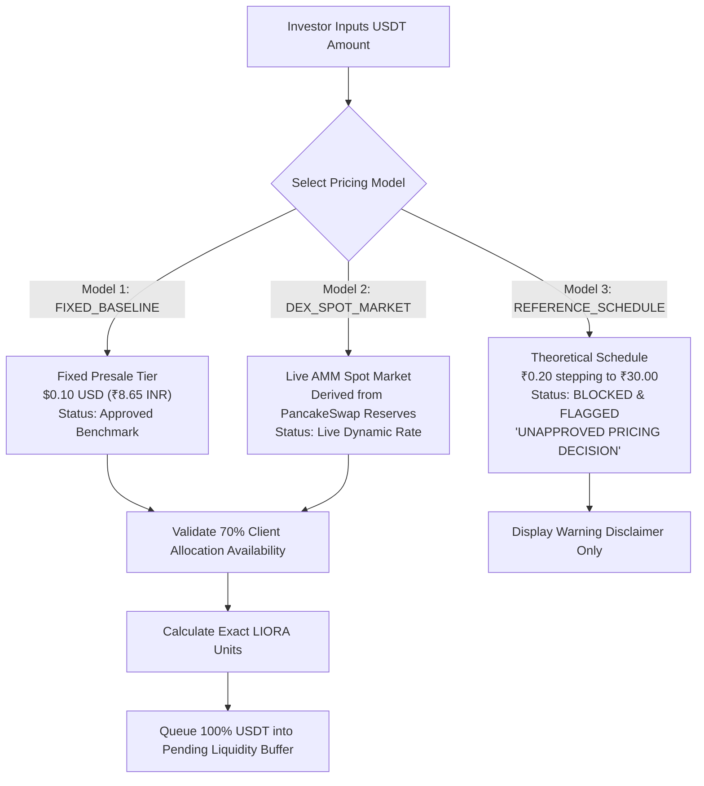

# LIORA COIN — Gate C9 Primary Token Sale Design
## Capital Formation, Purchase Routing & Quotation Architecture

**Project Root:** `D:\Projects\OXENIQ`  
**Network:** BNB Smart Chain Testnet (Chain ID: `97`)  
**Status:** Implemented & Verified  

---

## 1. Overview & Objectives

The primary token sale is the official mechanism through which clients and investors purchase LIORA directly from the project. In accordance with the confirmed Gate C8 management decisions:
1. **Direct Purchase:** Investors acquire LIORA tokens directly from the LIORA project rather than exclusively buying on secondary markets.
2. **100% Proceeds Routing:** Exactly 100% of all gross USDT proceeds are designated for protocol liquidity.
3. **Custody & Ownership:** Resulting PancakeSwap V2 LP tokens are minted directly into the company treasury wallet (`0xe31A2ec1474DfA2F5316dA0033f3Bd57F9D19350`).
4. **Supply Isolation:** All purchased tokens are distributed exclusively from the 70% Client Allocation bucket (700,000,000 LIORA), leaving the 30% Company Emergency Reserve (300,000,000 LIORA) untouched.

---

## 2. Quotation Models & Unapproved Pricing Safeguards

To prevent unauthorized pricing execution while management deliberates on final commercial policies, the engine implements three transparent quotation models:

### 2.1 Model 1: Fixed Baseline Presale Tier (`FIXED_BASELINE`)
- **Rate:** $0.10 USD per LIORA (₹8.65 INR at FX rate of ₹86.50/USD).
- **Formula:**
  $$\text{LIORA}_{\text{raw}} = \frac{\text{USDT}_{\text{raw}} \times 10^{18}}{\text{parseUnits}(\text{"0.10"}, 18)}$$
- **Example:** A deposit of 100 USDT delivers exactly 1,000 LIORA.
- **Suitability:** Predictable early-stage capital formation benchmark.

### 2.2 Model 2: Live PancakeSwap Spot Market (`DEX_SPOT_MARKET`)
- **Rate:** Current live AMM market price from the on-chain BSC Testnet pair (`0x64beE3847a766D35E6611985F3c3e51C78Af5D2c`).
- **Formula:**
  $$\text{Price}_{\text{USD}} = \frac{\text{Reserve}_{\text{mUSDT}}}{\text{Reserve}_{\text{LIORA}}}$$
- **Suitability:** Ensures the primary sale does not undercut or distort open-market decentralized exchange pricing.

### 2.3 Model 3: Theoretical Reference Schedule (`REFERENCE_SCHEDULE`)
- **Rate:** Formula-driven schedule starting at ₹0.20 and incrementing by ₹0.20 every 5 hours up to a ₹30.00 ceiling.
- **Safety Status:** **UNAPPROVED PRICING GUARD ACTIVE.**
- **Enforcement:** The engine marks any quote generated with this model with an explicit warning:
  > *UNAPPROVED PRICING DECISION: The reference-price schedule is a theoretical simulation and has NOT been approved as an enforceable primary sale execution price. Shown for preview comparison only.*
- Direct execution against this pricing schedule is strictly prevented until management confirms its contractual validity.

---

## 3. Safe Precision Arithmetic

JavaScript floating point operations (IEEE 754) introduce precision artifacts (e.g., `0.10` becoming `0.100000000000000006`). The `PrimaryTokenSaleEngine` avoids rounding drift via:
1. Converting decimal floats to normalized decimal strings using `toFixed(8).replace(/\.?0+$/, '')`.
2. Utilizing BigInt integer arithmetic via `viem` / `ethers` `parseUnits` and `formatUnits`.
3. Maintaining all internal token ledger balances strictly in 18-decimal base units ($10^{18} \text{ wei} = 1 \text{ token}$).

---

## 4. Primary Token Sale Terminal (UI Component)

The web application exposes a dedicated investor interface at `/sale`:
- **File:** [apps/web/src/components/sale/PrimarySaleTerminal.tsx](file:///d:/Projects/OXENIQ/apps/web/src/components/sale/PrimarySaleTerminal.tsx)
- **Features:**
  - Real-time balance inspection (LIORA, mUSDT, tBNB).
  - Pricing model toggle with clear visual badge indicators (`Approved Tier`, `Live AMM Spot`, `Unapproved Simulation`).
  - Allocation sufficiency checker (disables purchase if requested tokens exceed remaining 70% allocation).
  - Full transparency ledger showing exact USDT proceeds destined for protocol liquidity.
  - BSC Testnet isolation guard (warns and disables actions if connected to another network).

---

## 5. Security & Risk Controls

1. **Anti-Dilution Guard:** Purchases cannot exceed `availableClientAllocationRaw` (700M LIORA initial cap).
2. **Anti-Leakage Guard:** Proceeds are credited immediately to `usdtPendingLiquidityAllocationRaw`.
3. **No Key Exposure:** Signing is performed client-side through standard EIP-1193 MetaMask prompts; private keys are never handled by the backend or application state.
