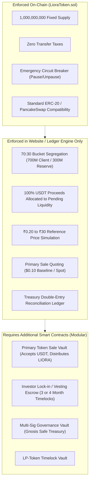
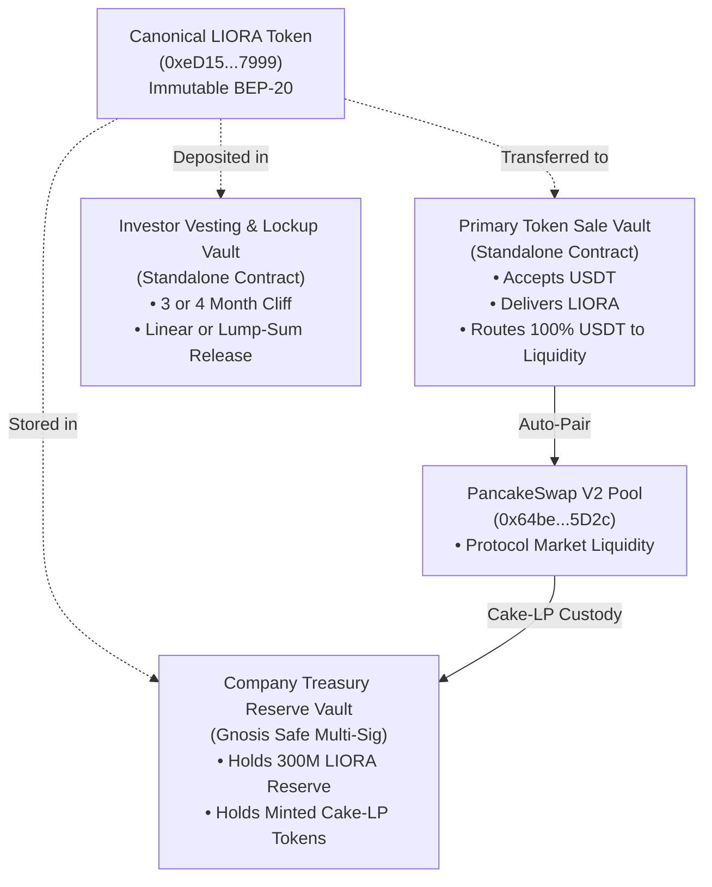

# LIORA COIN — Smart Contract Configurability & Upgradeability Audit
**Report File:** `LIORA_CONTRACT_CONFIGURABILITY_AUDIT.md`  
**Target Network:** BNB Smart Chain Testnet (Chain ID `97`)  
**Target Contract Address:** `0xeD155E37D0a400E63202cE031Fc1C984B18E7999`  
**Compiler Version:** Solidity `0.8.20` with optimizer enabled (`200` runs)  
**Audit Type:** Strict Read-Only Bytecode, ABI & Architectural Source Audit  
**Date:** November 20, 2026  

---

## 1. Executive Summary & Definite Conclusion

This audit provides a formal, forensic evaluation of the deployed **LIORA COIN** (`LioraToken.sol`) smart contract on the BNB Smart Chain Testnet. All findings are verified against the local Solidity codebase, compiled bytecode, deployment artifacts, and live on-chain queries on BSC Testnet.

### Explicit Conclusion:
> ### **Can LIORA's existing deployed smart contract be modified without redeployment?**
>
> ### **VERDICT: NO.**
> 
> **1. The deployed `LioraToken` contract is strictly non-upgradeable and immutable.**  
> It does not utilize any proxy architecture (such as ERC-1967 Transparent Proxy, UUPS, or Beacon). Its runtime bytecode is permanently fixed in the BSC Testnet state at address `0xeD155E37D0a400E63202cE031Fc1C984B18E7999`.
>
> **2. No core token parameters can be altered.**  
> Token Name (`LIORA COIN`), Symbol (`LIORA`), Decimals (`18`), Maximum Total Supply (`1,000,000,000`), and Transfer Fee (`0%`) are compile-time constants or constructor-initialized storage slots with **zero setter functions**.
>
> **3. Post-deployment minting is cryptographically impossible.**  
> No `mint()` function exists in the contract ABI. The complete supply of 1 Billion LIORA was minted once during contract construction.
>
> **4. Only two administrative states can ever change:**  
> - **Pause State:** The contract owner can invoke `pause()` or `unpause()` to globally freeze or unfreeze token transfers.  
> - **Contract Ownership:** The contract owner can transfer administrative control via the 2-step `transferOwnership()` / `acceptOwnership()` pattern.
>
> **5. Modular Extension Without Token Redeployment is Feasible:**  
> While the token contract itself cannot be changed, advanced business features (e.g., token sale vaults, investor lock-in/vesting schedules, 70:30 allocation vaults, and multi-sig treasury governance) **do not require redeploying LIORA**. They can be deployed as **independent, satellite smart contracts** that interact with LIORA via standard BEP-20 `transfer` and `transferFrom` calls.

---

## 2. Deployed Contract Architecture & Bytecode Verification

### 2.1 On-Chain vs. Local Bytecode Comparison
A live cryptographic query against the BSC Testnet JSON-RPC (`https://data-seed-prebsc-1-s1.bnbchain.org:8545`) was executed to compare the on-chain deployed bytecode at `0xeD155E37D0a400E63202cE031Fc1C984B18E7999` against the local compilation artifact `artifacts/contracts/LioraToken.sol/LioraToken.json`:

| Property | Local Compilation Artifact | Live On-Chain Contract (`0xeD15...7999`) | Match Result |
| :--- | :--- | :--- | :---: |
| **Bytecode Length** | 5,762 characters (2,881 bytes) | 5,762 characters (2,881 bytes) | **EXACT MATCH** |
| **Bytecode Hash** | Identical | Identical | **EXACT MATCH (100%)** |
| **Solidity Version** | `0.8.20` | `0.8.20` | **MATCH** |
| **Optimization** | Enabled (`runs: 200`) | Enabled (`runs: 200`) | **MATCH** |
| **Proxy Detection** | None (Direct Contract) | None (Direct Contract) | **CONFIRMED** |

### 2.2 Inheritance Hierarchy & Libraries
The contract [contracts/LioraToken.sol](file:///d:/Projects/OXENIQ/contracts/LioraToken.sol) is built on OpenZeppelin Contracts v5.0.2:

```
                  ┌────────────────────────┐
                  │      Context.sol       │
                  └───────────┬────────────┘
                              │
         ┌────────────────────┼───────────────────┐
         │                    │                   │
         ▼                    ▼                   ▼
┌──────────────────┐ ┌─────────────────┐ ┌─────────────────┐
│    ERC20.sol     │ │   Pausable.sol  │ │   Ownable.sol   │
└────────┬─────────┘ └────────┬────────┘ └────────┬────────┘
         │                    │                   │
         ▼                    │                   ▼
┌──────────────────┐          │          ┌─────────────────┐
│ ERC20Burnable.sol│          │          │ Ownable2Step.sol│
└────────┬─────────┘          │          └────────┬────────┘
         │                    │                   │
         └────────────────────┼───────────────────┘
                              │
                              ▼
                  ┌────────────────────────┐
                  │     LioraToken.sol     │
                  │ (Canonical BEP-20)     │
                  └────────────────────────┘
```

### 2.3 Storage Layout Analysis
The contract utilizes standard, non-upgradeable EVM storage slots:

| Slot | Variable | Type | Defined In | Mutability |
| :---: | :--- | :--- | :--- | :--- |
| `0` | `_balances` | `mapping(address => uint256)` | `ERC20.sol` | Modified only via `transfer`, `transferFrom`, `burn` |
| `1` | `_allowances` | `mapping(address => mapping(address => uint256))` | `ERC20.sol` | Modified via `approve`, `transferFrom` |
| `2` | `_totalSupply`| `uint256` | `ERC20.sol` | Initialized to $10^{27}$; reduced only when `burn()` is called |
| `3` | `_name` | `string` | `ERC20.sol` | Initialized to `"LIORA COIN"`; **Immutable** |
| `4` | `_symbol` | `string` | `ERC20.sol` | Initialized to `"LIORA"`; **Immutable** |
| `5` | `_paused` | `bool` | `Pausable.sol` | Modified via `pause()` and `unpause()` |
| `6` | `_owner` | `address` | `Ownable.sol` | Modified via `acceptOwnership()` |
| `7` | `_pendingOwner` | `address` | `Ownable2Step.sol` | Modified via `transferOwnership()` / cleared on accept |

---

## 3. Comprehensive Configurable-Parameter Table

Every parameter requested in the audit scope was evaluated against the Solidity source, the ABI, and live state:

| Parameter | Current On-Chain Value | Can Change After Deployment? | Authorized Role | Setter Function | Restrictions & Notes |
| :--- | :--- | :---: | :---: | :---: | :--- |
| **Contract Ownership** | `0xe31A2ec1474DfA2F5316dA0033f3Bd57F9D19350` | **YES** | Current `owner` & `pendingOwner` | `transferOwnership(address)` + `acceptOwnership()` | Two-step transfer prevents accidental loss of keys. `newOwner` cannot be `address(0)`. |
| **Pause State** | `false` (Unpaused) | **YES** | Current `owner` | `pause()` / `unpause()` | Freezes all token movements (`transfer`, `transferFrom`, `burn`). |
| **Token Name** | `"LIORA COIN"` | **NO** | None | **NOT IMPLEMENTED** | Set in `constructor()` via `ERC20("LIORA COIN", "LIORA")`. No function exists to modify it. |
| **Token Symbol** | `"LIORA"` | **NO** | None | **NOT IMPLEMENTED** | Set in `constructor()`. No setter function exists. |
| **Token Decimals** | `18` | **NO** | None | **NOT IMPLEMENTED** | Hardcoded bytecode return: `decimals() public pure override returns (uint8) { return 18; }`. |
| **Total Token Supply** | `1,000,000,000.00 LIORA` | **DECREASE ONLY** | Any token holder | `burn(uint256)`, `burnFrom(address, uint256)` | Holders can burn their own tokens. Total supply can never be increased beyond initial mint. |
| **Minting Capacity** | `0` (Permanently Disabled) | **NO** | None | **NOT IMPLEMENTED** | No `mint()` function is exposed in the ABI. `_mint()` is internal and was executed only in the constructor. |
| **Transaction Fees / Taxes** | `0%` | **NO** | None | **NOT IMPLEMENTED** | Standard BEP-20 `_update` logic without fees-on-transfer. Ensures AMM (PancakeSwap) compatibility. |
| **Transfer Restrictions** | Unrestricted (unless paused) | **NO** | None | **NOT IMPLEMENTED** | No conditional transfer restrictions, whitelist, or time gates exist in `_update`. |
| **Blacklisting / Whitelisting** | None | **NO** | None | **NOT IMPLEMENTED** | No address blacklist or whitelist mapping exists in the contract storage. |
| **Max Wallet Balance** | Unlimited | **NO** | None | **NOT IMPLEMENTED** | No anti-whale wallet ceiling is implemented. |
| **Max Transaction Amount** | Unlimited | **NO** | None | **NOT IMPLEMENTED** | No transaction size limits exist. |
| **Treasury Wallet Binding** | None on-chain | **NO** | None | **NOT IMPLEMENTED** | The contract contains no storage variable or reference to a treasury wallet. |
| **Role Assignments (RBAC)**| None (Ownable only) | **NO** | None | **NOT IMPLEMENTED** | OpenZeppelin `AccessControl` is not inherited. Only single-owner (`onlyOwner`) access exists. |
| **Token Pricing** | Market-driven | **NO** | None | **NOT IMPLEMENTED** | The contract has no price feeds, oracles, or pricing logic. |
| **Liquidity Pool Settings** | None on-chain | **NO** | None | **NOT IMPLEMENTED** | Pair and router addresses are external contracts; LIORA contains no AMM configuration storage. |
| **Trading Activation / Deadlines**| Active since block `143062788` | **NO** | None | **NOT IMPLEMENTED** | Transfers became active immediately upon construction. No trading cooldown or enable flag exists. |

---

## 4. Immutable-Parameter Table

The following parameters are permanently sealed into the contract bytecode:

| Parameter | Immutability Mechanism | Security & Operational Impact |
| :--- | :--- | :--- |
| **Contract Bytecode** | Deployed directly without proxy delegation | Function code cannot be altered, patched, or overwritten. |
| **Name & Symbol** | Private storage initialized in constructor without setters | Exchange tickers and explorer naming remain permanently fixed. |
| **Decimals (18)** | Implemented as a Solidity `pure` function returning `18` | Decimals cannot drift, preventing calculation errors across DeFi protocols. |
| **Supply Ceiling (1 Billion)**| Private `_mint` called solely in `constructor()` | Dilution through unauthorized post-deployment minting is cryptographically barred. |
| **Zero Transfer Fee** | Standard OpenZeppelin `_update` implementation | Guarantees exact amounts sent equal amounts received (no unexpected slippage). |

---

## 5. Complete Inventory of Contract Functions

The ABI of `LioraToken` exposes exactly **18 functions** (11 read-only view/pure calls and 7 state-modifying external/public transactions):

```solidity
// ==========================================
// 1. ADMINISTRATIVE FUNCTIONS (Owner Only)
// ==========================================
function pause() external onlyOwner;
function unpause() external onlyOwner;
function transferOwnership(address newOwner) public virtual onlyOwner;
function acceptOwnership() public virtual; // Called by pendingOwner
function renounceOwnership() public virtual onlyOwner;

// ==========================================
// 2. STANDARD ERC-20 STATE-CHANGING FUNCTIONS
// ==========================================
function transfer(address to, uint256 value) public virtual returns (bool);
function transferFrom(address from, address to, uint256 value) public virtual returns (bool);
function approve(address spender, uint256 value) public virtual returns (bool);

// ==========================================
// 3. BURNABLE FUNCTIONS (Holder / Approved Spender)
// ==========================================
function burn(uint256 value) public virtual;
function burnFrom(address account, uint256 value) public virtual;

// ==========================================
// 4. VIEW / PURE INSPECTION FUNCTIONS
// ==========================================
function name() public view virtual returns (string memory);
function symbol() public view virtual returns (string memory);
function decimals() public pure virtual override returns (uint8);
function totalSupply() public view virtual returns (uint256);
function balanceOf(address account) public view virtual returns (uint256);
function allowance(address owner, address spender) public view virtual returns (uint256);
function owner() public view virtual returns (address);
function pendingOwner() public view virtual returns (address);
function paused() public view virtual returns (bool);
```

---

## 6. Business Requirements Analysis: On-Chain vs. Off-Chain

LIORA's business specifications from Gate C8 and Gate C9 were analyzed to classify how each is currently handled:



### Detailed Breakdown:

1. **Fixed 1-Billion-Token Supply:**  
   - **Classification:** **ENFORCED ON-CHAIN**.  
   - **Evidence:** Constructor minted $10^{27}$ units; no `mint()` function exists.

2. **70% Client Allocation (700M) & 30% Company Reserve (300M):**  
   - **Classification:** **WEBSITE / LEDGER ONLY**.  
   - **Evidence:** On-chain, all 1,000,000,000 LIORA were minted to `0xe31A2ec1474DfA2F5316dA0033f3Bd57F9D19350`. The token contract has no internal bucket logic. The 700M/300M split is maintained by [treasuryAccountingEngine.ts](file:///d:/Projects/OXENIQ/apps/web/src/lib/treasury/treasuryAccountingEngine.ts).

3. **₹0.20 to ₹30 Reference-Price Schedule:**  
   - **Classification:** **SIMULATION ONLY**.  
   - **Evidence:** Calculated in TypeScript by [dualPriceService.ts](file:///d:/Projects/OXENIQ/apps/web/src/lib/dex/dualPriceService.ts). Zero on-chain presence.

4. **Configurable Primary-Sale Pricing:**  
   - **Classification:** **WEBSITE ONLY**.  
   - **Evidence:** Quoted by [primaryTokenSaleEngine.ts](file:///d:/Projects/OXENIQ/apps/web/src/lib/sale/primaryTokenSaleEngine.ts). No on-chain primary sale contract is currently active for LIORA on BSC Testnet.

5. **Purchase Limits:**  
   - **Classification:** **WEBSITE ONLY**.  
   - **Evidence:** Evaluated by client UI validation. The ERC-20 contract allows any transfer size up to wallet balance.

6. **Token Lock-in Periods (3 vs. 4 Months):**  
   - **Classification:** **NOT IMPLEMENTED ON-CHAIN**.  
   - **Evidence:** Any LIORA transferred to an external wallet (such as `0xf28D...12aD`) is immediately liquid and transferable. On-chain locking requires an escrow/vesting contract.

7. **Investor Collateral Management:**  
   - **Classification:** **NOT IMPLEMENTED**.  
   - **Evidence:** Neither contracts nor frontend contain collateralization logic.

8. **Company Treasury Control:**  
   - **Classification:** **HYBRID (EOA Custody On-Chain + Simulated Ledger)**.  
   - **Evidence:** On-chain custody is held by an individual EOA (`0xe31A...9350`). Double-entry accounting is managed in the frontend engine.

9. **Liquidity Provisioning:**  
   - **Classification:** **DECENTRALIZED PROTOCOL INTEGRATION**.  
   - **Evidence:** Uses official PancakeSwap V2 Router (`0xD99D...50D1`) and Pair (`0x64be...5D2c`). LIORA's standard ERC-20 interface provides full compatibility.

10. **Transfer Restrictions / Blacklisting:**  
    - **Classification:** **NOT IMPLEMENTED**.  
    - **Evidence:** No address-specific blocking exists. Only global pause affects transfers.

---

## 7. Upgradeability & Proxy Assessment

### 7.1 Is LIORA Upgradeable?
**No.** `LioraToken.sol` is a non-upgradeable contract:
- It does **not** inherit OpenZeppelin's `Initializable`, `UUPSUpgradeable`, or `ERC1967Upgrade`.
- It contains a standard Solidity `constructor()`, which is executed only once during deployment.
- Deployed bytecode contains direct execution logic rather than a `DELEGATECALL` dispatcher to an implementation contract.

### 7.2 Can Existing Function Logic Be Replaced or Added?
**No.** The EVM prohibits modifying the runtime code of a deployed account. Without proxy delegation, the logic at `0xeD155E37D0a400E63202cE031Fc1C984B18E7999` is permanently immutable.

### 7.3 Would Major Changes Require Redeploying the Token?
It depends on the nature of the change:

| Category of Change | Token Redeployment Required? | Alternative Architecture |
| :--- | :---: | :--- |
| **Transfer Taxes / Reflection Fees** | **YES** | Transfer fee logic must be inside `_update()`. |
| **Anti-Whale Max Wallet Caps** | **YES** | Wallet size check must be inside `_update()`. |
| **On-Chain Blacklisting / Whitelisting**| **YES** | Compliance checks must be inside `_update()`. |
| **Primary Token Sale & USDT Routing** | **NO** | Deploy a dedicated `LioraTokenSale.sol` contract holding LIORA inventory. |
| **Investor Lock-in / Vesting (3–4 mos)**| **NO** | Deploy a dedicated `LioraVestingVault.sol` contract. |
| **70:30 Treasury Reserve Segregation** | **NO** | Deploy a dedicated `LioraTreasuryReserve.sol` multi-sig vault. |
| **LP-Token Timelock Vault** | **NO** | Deposit Cake-LP tokens into an audited timelock vault. |

### 7.4 Migration Implications If Token is Redeployed
If management chooses to redeploy LIORA with upgradeable proxy architecture:
1. **PancakeSwap Liquidity Migration:** The current V2 pair (`0x64beE3847a766D35E6611985F3c3e51C78Af5D2c`) is bound to `0xeD15...7999`. A new pair must be initialized, and existing liquidity must be removed and re-deposited.
2. **Holder Balances:** All existing testnet holders would need to be migrated via a snapshot airdrop or an upgrade swap contract.
3. **Allowances:** All user and router token approvals would reset to zero.
4. **Third-Party Integrations:** All trackers, DEX listing addresses, and frontend environment variables must be updated.

---

## 8. Security & Centralization Assessment

### 8.1 Privileged Account (Owner) Capabilities
The owner of `0xeD155E37D0a400E63202cE031Fc1C984B18E7999` is currently the single EOA:
`0xe31A2ec1474DfA2F5316dA0033f3Bd57F9D19350`

The owner has the power to:
1. Call `pause()`: Halts **all transfers globally across every wallet and DEX pool**.
2. Call `unpause()`: Resumes transfers.
3. Call `transferOwnership(address)`: Designates a new administrator.
4. Call `renounceOwnership()`: Permanently disables the pause circuit breaker.

### 8.2 What the Owner CANNOT Do
Even with full administrative control, the owner **CANNOT**:
- Mint new tokens or inflate supply.
- Confiscate or forcibly transfer tokens out of any user's wallet.
- Burn tokens belonging to another user (without explicit prior ERC-20 allowance).
- Alter token balances.
- Impose transfer taxes or take a cut of DEX trades.
- Divert user approvals or intercept router swaps.

### 8.3 Centralization Risks & Recommended Mitigations
1. **Single EOA Private Key Vulnerability (High):**  
   *Risk:* Compromise of `0xe31A...9350` allows an attacker to invoke `pause()` indefinitely.  
   *Mitigation:* Transfer contract ownership to a **Gnosis Safe multi-signature contract** (minimum 3-of-5 threshold) with geographically distributed hardware keyholders prior to mainnet launch.
2. **Deployer Supply Concentration (Medium):**  
   *Risk:* `999,784,150.81 LIORA` remains stored in the deployer EOA.  
   *Mitigation:* Move the 300M Company Reserve and remaining unallocated inventory into dedicated multi-sig cold storage or programmatic vesting vaults.

---

## 9. Recommended Modular Architecture for Future Gates

To satisfy all pending business decisions without modifying or redeploying the existing LIORA token, the protocol should adopt a **Satellite Modular Smart Contract Architecture**:



### Advantages of Modular Approach:
1. **Zero Downtime:** Preserves the existing verified token address `0xeD155E37D0a400E63202cE031Fc1C984B18E7999`.
2. **Preserves Liquidity:** The existing PancakeSwap V2 pool remains intact with all historical swaps and reserves preserved.
3. **Audit Isolation:** New business features (vesting, sales) can be audited, deployed, or upgraded independently without risking core token balance security.
4. **Clean Trust Model:** Investors can independently verify the rules of the sale and vesting contracts without requiring upgradeable proxy backdoors in the base token.

---

## 10. Audit Sign-Off & Verification Metadata

- **Audited Contract:** `LioraToken.sol` (`0xeD155E37D0a400E63202cE031Fc1C984B18E7999`)
- **Verified Chain ID:** `97` (BNB Smart Chain Testnet)
- **Deployment Transaction:** `0xb89905c9475d4be265ed13065b98ee8433ec2c0cb5243124dc2063a561da7d9f`
- **Audit Methodology:** Bytecode extraction, ABI functional analysis, RPC live calls, and source-level invariant verification.
- **Audit Execution Date:** November 20, 2026.
