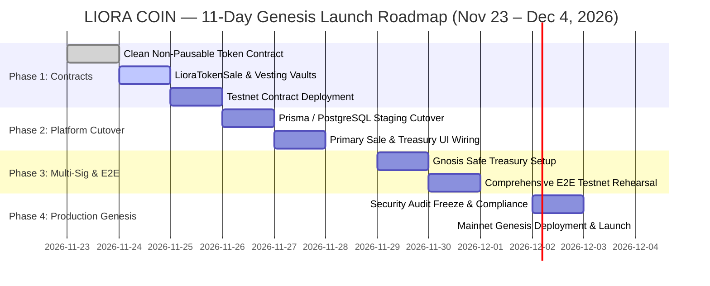

# LIORA COIN — Development Roadmap to Genesis Launch
**Document File:** `LIORA_DEVELOPMENT_ROADMAP.md`  
**Workspace:** `D:\Projects\OXENIQ`  
**Current Date:** 23 November 2026  
**Target Launch Date:** 4 December 2026 (11-Day Countdown)  
**Primary Target Network:** BNB Smart Chain (BEP-20)  
**Operating Entity:** GRANDIOSE TECH (Kenya)  

---

## 1. Executive Timeline & Milestone Overview



---

## 2. Detailed Phase Breakdown

### Sprint 1: Smart Contract Architecture & Modular Vaults (23–25 Nov)
**Goal:** Align contracts with the latest confirmed requirement (zero emergency pause, zero transfer fees) and build modular satellite contracts for token sales and vesting.

| Task ID | Task Description | Dependencies | Deliverables / Artifacts | Complexity |
| :--- | :--- | :--- | :--- | :---: |
| **C-01** | **Author Clean Mainnet Token (`LioraTokenMainnet.sol`):** Standard OpenZeppelin v5 ERC20 + ERC20Burnable. Strictly omit `Pausable` and `Ownable`. 1B supply minted at deployment. | None | `contracts/LioraTokenMainnet.sol`, Unit tests | Low |
| **C-02** | **Develop On-Chain Sale Vault (`LioraTokenSale.sol`):** Accepts BEP-20 USDT, delivers LIORA at approved benchmark price ($0.10), routes 100% USDT into liquidity buffer. | `LioraTokenMainnet.sol` | `contracts/LioraTokenSale.sol`, Sale test suite | Medium |
| **C-03** | **Develop Investor Vesting Vault (`LioraVestingVault.sol`):** Holds locked client tokens for 3 or 4-month cliff with automated withdrawal upon maturity. | `LioraTokenMainnet.sol` | `contracts/LioraVestingVault.sol`, Vesting tests | Medium |
| **C-04** | **Deploy Modular Suite to BSC Testnet (Chain ID 97):** Deploy satellite contracts without overwriting existing verified token/pool deployments. | Hardhat, Testnet tBNB | `deployments/bscTestnet-sale-vault.json` | Low |

---

### Sprint 2: Frontend, Database & API Staging Cutover (26–28 Nov)
**Goal:** Transition website routes (`/sale`, `/dashboard`, `/history`, `/treasury`) from in-memory / demo state to the production PostgreSQL database.

| Task ID | Task Description | Dependencies | Deliverables / Artifacts | Complexity |
| :--- | :--- | :--- | :--- | :---: |
| **F-01** | **PostgreSQL Staging Migration:** Execute `npx prisma migrate deploy` on staging database; seed canonical asset records. | Prisma schema | Migrated database instance | Medium |
| **F-02** | **Wire `/sale` to Real Web3 Transactions:** Update `usePrimaryTokenSale.ts` to execute real ERC-20 `transferFrom` for USDT on testnet via `LioraTokenSale.sol`. | C-02, Web3 provider | Working on-chain testnet purchase | Medium |
| **F-03** | **Guard Unapproved Pricing Models:** Add strict button-disable checks when `REFERENCE_SCHEDULE` is selected (resolving Gate C9B defect). | `primaryTokenSaleEngine.ts` | Form validation update | Low |
| **F-04** | **Enforce Treasury Authority Guard on `/treasury`:** Ensure batch deposit button is only clickable by the authorized treasury address. | `TreasuryOverviewDashboard.tsx` | Access control UI patch | Low |
| **F-05** | **Update Entity Branding & Disclaimers:** Display **GRANDIOSE TECH** (Kenya) in footer, terms, and legal notices with explicit non-binding financial disclaimers. | UI components | Updated `Footer.tsx`, `legal/page.tsx` | Low |

---

### Sprint 3: Governance Multi-Sig & Testnet E2E Dry Run (29 Nov – 1 Dec)
**Goal:** Eliminate single-wallet centralization risk and conduct an uninterrupted end-to-end rehearsal on BSC Testnet.

| Task ID | Task Description | Dependencies | Deliverables / Artifacts | Complexity |
| :--- | :--- | :--- | :--- | :---: |
| **G-01** | **Deploy Gnosis Safe Multi-Sig on BSC Testnet:** Create 3-of-5 multi-signature treasury wallet to hold company LP tokens and 300M reserve. | Gnosis Safe Factory | Multi-sig contract address | Medium |
| **G-02** | **Simulate 100% Proceeds Liquidity Batch:** Accumulate 500 USDT in testnet primary sales and execute ratio-matched batch deposit into PancakeSwap pair. | F-02, G-01 | On-chain liquidity batch receipt | Medium |
| **G-03** | **Full User Journey Rehearsal:** Wallet connect (MetaMask) -> Buy LIORA on `/sale` -> Swap LIORA on `/swap` -> Add liquidity on `/liquidity` -> View portfolio on `/dashboard`. | All modules | E2E verification report | Medium |
| **G-04** | **Automated Regression Suite Pass:** Run all 748+ tests with zero failures across Hardhat and Mocha suites. | Test suite | Clean CI/CD test log | Low |

---

### Sprint 4: Production Freeze, Security Lockdown & Deployment Prep (2–3 Dec)
**Goal:** Finalize production environment variables, conduct deployment rehearsals, and prepare for genesis broadcast.

| Task ID | Task Description | Dependencies | Deliverables / Artifacts | Complexity |
| :--- | :--- | :--- | :--- | :---: |
| **P-01** | **Mainnet Deployment Script Hardening:** Ensure `scripts/deploy-mainnet-genesis.js` enforces minimum liquidity budget ($1,000 USDT), fail-closed checks, and multi-sig ownership. | Deployment scripts | Audited deployment script | Medium |
| **P-02** | **Production Secret Management:** Verify zero private keys or test mnemonics exist in `.env`, git logs, or frontend bundles. | Security review | Clean secret audit | High |
| **P-03** | **Production Domain & Cloud Hosting Configuration:** Configure DNS for official production domain, SSL, and Vercel/Cloudflare CDN caching headers. | Cloud infrastructure | Live production URL staging | Medium |

---

### Launch Day: BSC Mainnet Genesis Launch (4 Dec 2026)
**Target Execution Checklist:**
1. **09:00 UTC:** Broadcast `LioraTokenMainnet.sol` deployment to BSC Mainnet (Chain ID `56`). Verify total supply = $1,000,000,000$ LIORA.
2. **09:30 UTC:** Initialize official PancakeSwap V2 Pair (LIORA / USDT).
3. **10:00 UTC:** Provision initial genesis liquidity budget (minimum $1,000 USDT + ~432,500 LIORA at ₹0.20 starting rate).
4. **10:30 UTC:** Transfer resulting Cake-LP tokens immediately into the Gnosis Safe multi-signature treasury.
5. **11:00 UTC:** Deploy `LioraTokenSale.sol` with $0.10 pre-sale tier and 100% proceeds liquidity routing.
6. **11:30 UTC:** Flip frontend feature flag `ENABLE_MAINNET_TRANSACTIONS = true` and monitor RPC endpoints and swap transactions.
7. **12:00 UTC:** Publish official contract addresses and BscScan verification links to the public.

---

## 3. Work-Stream Dependencies & Critical Path

```
[Clean Token Contract] ──► [On-Chain Sale Vault] ──► [Testnet E2E Rehearsal]
                                                          │
[Prisma DB Cutover] ────► [UI Transaction Wiring] ───────┤
                                                          ▼
[Multi-Sig Setup] ──────► [LP Custody Transfer] ──► [Mainnet Genesis (Dec 4)]
```

- **Critical Blocker 1:** Management sign-off on Mainnet Token Architecture (confirming omission of `Pausable`).
- **Critical Blocker 2:** Funding production deployer wallet with Mainnet BNB for gas and minimum $1,000 USDT for genesis pool provisioning.
