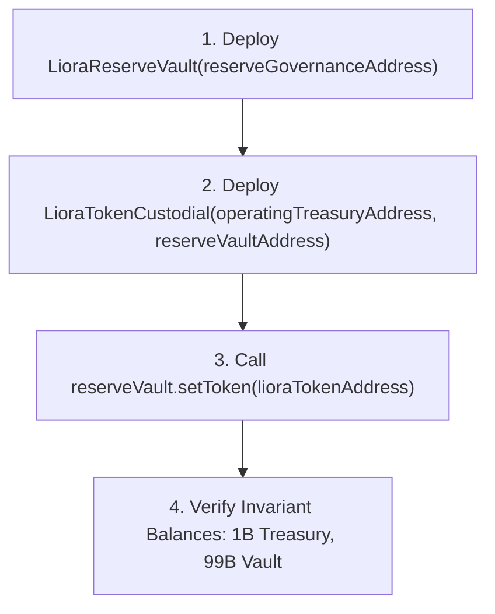

# LIORA COIN — BNB Smart Chain Mainnet Deployment Readiness Checklist

**Target Network:** BNB Smart Chain (BSC Mainnet Chain ID `56`)  
**Operating Entity:** GRANDIOSE TECH (Nairobi, Kenya)  
**Genesis Launch Target:** 4 December 2026  
**Contract Architecture:** Fixed 100B Supply (`LioraTokenCustodial.sol` + `LioraReserveVault.sol`)  
**Audit Date:** 23 November 2026  
**Status:** MAINNET DEPLOYMENT BLOCKED PENDING FORMAL MANAGEMENT AUTHORIZATION  

---

## 1. Categorized Readiness Summary

To maintain strict operational integrity, all components are classified into four distinct stages of truth:

```
[COMPLETED IMPLEMENTATION] ──> [SIMULATED / SANDBOX TESTED] ──> [REAL BSC TESTNET] ──> [PENDING MAINNET]
```

### 1.1 Status Matrix

| Component | Status | Details |
| :--- | :--- | :--- |
| **Fixed 100B Token Bytecode** | **COMPLETED IMPLEMENTATION** | [LioraTokenCustodial.sol](file:///d:/Projects/OXENIQ/contracts/LioraTokenCustodial.sol) compiled with zero warnings. |
| **Reserve Vault Bytecode** | **COMPLETED IMPLEMENTATION** | [LioraReserveVault.sol](file:///d:/Projects/OXENIQ/contracts/LioraReserveVault.sol) with `Ownable2Step` multi-sig governance. |
| **Deployment Engine** | **COMPLETED IMPLEMENTATION** | [scripts/deploy-liora-custodial-supply.js](file:///d:/Projects/OXENIQ/scripts/deploy-liora-custodial-supply.js) ready with fail-closed safety guards. |
| **13-Point Core Functional Suite** | **SIMULATED / UNIT-TESTED** | 13/13 passing in [Phase2B_FinalSupplyAndMainnetMVP.test.js](file:///d:/Projects/OXENIQ/test/Phase2B_FinalSupplyAndMainnetMVP.test.js). |
| **Option A RBAC Enforcement** | **SIMULATED / SANDBOX TESTED** | Read-only investor routes & HTTP 403 transfer barriers verified. |
| **Manual Payment Verification** | **SIMULATED / SANDBOX TESTED** | `CustodialAllocationLedger.ts` double-entry tracking & deduplication verified. |
| **Historical Testnet Deployments** | **REAL BSC TESTNET** | Legacy token deployed on BSC Testnet (`0x651c...`); Testnet USDT pair provisioned. |
| **Custodian Multi-Sig Setup** | **PENDING MAINNET ACTIVITY** | Gnosis Safe / BSC multi-sig signers awaiting board ratification. |
| **Mainnet Gas Token Funding** | **PENDING MAINNET ACTIVITY** | Deployer account requires ~0.05 BNB for contract creation & gas reserves. |
| **PancakeSwap Liquidity Seeding** | **PENDING MAINNET ACTIVITY** | $100,000 USDT pairing awaiting Kenyan entity treasury capital deposit. |
| **Mainnet Contract Deployment** | **PENDING MAINNET ACTIVITY** | Blocked by hardcoded safety gate (`chainId === 56` throws error). |

---

## 2. Pre-Flight Configuration & Constructor Specifications

### 2.1 Contract Deployment Ordering

Deployments must be executed sequentially via `scripts/deploy-liora-custodial-supply.js`:



### 2.2 Constructor Parameters & Target Addresses

| Parameter | Type | Required Value / Policy | Mainnet Staging |
| :--- | :--- | :--- | :--- |
| **`LioraReserveVault` Constructor** | | | |
| `initialGovernance_` | `address` | Corporate Multi-Sig Address (e.g., Gnosis Safe 3-of-5). Must NOT be an EOA. | `TBD_GOVERNANCE_MULTISIG` |
| **`LioraTokenCustodial` Constructor** | | | |
| `operatingTreasury_` | `address` | Authorized corporate treasury operational wallet (receives 1,000,000,000 LIORA). | `TBD_OPERATING_TREASURY` |
| `reserveVault_` | `address` | Deployed address of `LioraReserveVault` (receives 99,000,000,000 LIORA). | Dynamically linked from Step 1 |
| **`setToken` Call** | | | |
| `token_` | `address` | Deployed address of `LioraTokenCustodial`. | Dynamically linked from Step 2 |

---

## 3. Gas Estimation & Economic Planning

Estimates calculated based on Solidity compiler `0.8.20` (`paris` EVM, optimizer runs `200`) and standard BSC base gas price of `3 gwei`:

| Operation | Estimated Gas Units | BNB Cost (@ 3 gwei) | USD Cost (@ $650/BNB) |
| :--- | :--- | :--- | :--- |
| **Deploy `LioraReserveVault`** | ~520,000 | 0.00156 BNB | $1.01 |
| **Deploy `LioraTokenCustodial`** | ~890,000 | 0.00267 BNB | $1.74 |
| **`reserveVault.setToken(...)`** | ~45,000 | 0.000135 BNB | $0.09 |
| **DEX Router `approve(...)`** | ~46,000 | 0.000138 BNB | $0.09 |
| **PancakeSwap V2 Pair Creation** | ~2,100,000 | 0.00630 BNB | $4.10 |
| **Initial `addLiquidity(...)`** | ~180,000 | 0.00054 BNB | $0.35 |
| **Total Estimated Genesis Gas** | **~3,781,000** | **~0.01134 BNB** | **~$7.38** |

> [!TIP]
> Maintain at least **0.10 BNB** in the deployer wallet prior to execution to handle network congestion spikes without transaction drop.

---

## 4. Contract Verification & Non-Upgradeability Audit

### 4.1 BscScan Verification Readiness
- **Compiler Version:** `v0.8.20+commit.a1b79f`
- **Optimization:** Enabled (`200` runs)
- **EVM Target:** `paris` (standard for BSC)
- **License Type:** MIT
- **Dependencies:** Flattenable via `npx hardhat flatten` or directly verifiable via `@nomicfoundation/hardhat-verify` using BscScan API key.

### 4.2 Immutability & Upgrade Limitations
- **No Proxy Dispatchers:** The contracts do not use ERC-1967, UUPS, Diamond, or Transparent Upgradeable Proxy patterns.
- **No Self-Destruct or Delegatecall:** The bytecode contains neither `SELFDESTRUCT` nor `DELEGATECALL`.
- **Permanent Supply Ceiling:** The contract contains no `mint()` function. Once deployed, the 100 Billion cap is physically irreversible.
- **Rollback Limitations:** Because the contracts are immutable, any post-deployment logic change requires:
  1. Deploying a new contract.
  2. Migrating treasury and reserve balances.
  3. Updating all frontend endpoints and AMM liquidity pools.

---

## 5. PancakeSwap V2 Liquidity Pool Creation Prerequisites

To establish trading on PancakeSwap V2 upon Mainnet launch, the following criteria must be satisfied:

1. **Target AMM Pair:** LIORA / USDT on BNB Smart Chain Mainnet.
2. **Canonical Mainnet Addresses:**
   - **PancakeSwap V2 Factory:** `0xcA143Ce32Fe78f1f7019d7d551a6402fC5350c73`
   - **PancakeSwap V2 Router:** `0x10ED43C718714eb63d5aA57B78B54704E256024E`
   - **Mainnet BSC-USD (USDT):** `0x55d398326f99059fF775485246999027B3197955`
3. **Liquidity Pool Sizing & Price Invariant:**
   - Desired Genesis Price: **$0.10 USDT per LIORA**.
   - Planned Seed Capital: **100,000 USDT** paired with **1,000,000 LIORA** from the Operating Treasury free balance.
   - Sizing check: Operating Treasury holds 1,000,000,000 LIORA, easily accommodating the 1,000,000 LIORA seed (0.1% of operating treasury).
4. **Liquidity Token Custody (Cake-LP):**
   - The received LP tokens must be transferred to the corporate multi-sig or locked in a verified third-party vesting locker (e.g. Unicrypt/PinkSale) to protect market confidence against rug-pull concerns.

---

## 6. Unresolved Production Blockers

Prior to Mainnet genesis on 4 December 2026, the following items remain strictly unresolved:

1. **Formal Mainnet Authorization:** Executive management has not yet issued written authorization to execute transactions on Chain ID 56.
2. **Multi-Sig Governance Hardware Keys:** Setup of the 3-of-5 Gnosis Safe for Kenyan corporate directors has not been confirmed.
3. **Real Fiat Settlement Bank API:** Automated bank feed integrations remain deferred; manual reconciliation protocols must be staffed with trained compliance personnel.
4. **Legal Entity Compliance Review:** Final regulatory clearance for the sale of tokens under Kenyan Capital Markets Authority (CMA) guidelines is pending completion.
