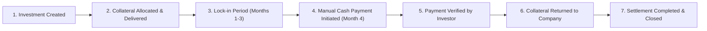

# LIORA COIN — Manual Investment Settlement Architecture & Lifecycle Design
**Document Version:** 1.0.0  
**Date:** 23 November 2026  
**Status:** ARCHITECTURAL DESIGN SPECIFICATION (NON-EXECUTABLE)  
**Workspace:** `D:\Projects\OXENIQ`  
**Operating Entity:** GRANDIOSE TECH (Kenya)  
**Authoritative Reference:** `LIORA COIN — FINAL MANAGEMENT CLARIFICATION CHECKLIST (3).docx` & Newly Confirmed Management Clarification (Sprint 1)  

---

> [!IMPORTANT]
> **Awaiting Management Approval:** This document is an architectural design and operational model specification only. In accordance with strict project guidelines, the investment withdrawal, settlement execution, and cash payout mechanisms are **NOT** implemented or activated in software or smart contracts until formal sign-off.

---

## 1. Executive Summary & Confirmed Business Model

Management has established a distinct hybrid operational model for LIORA COIN investments:
1. **Collateralized Token Delivery:** When an investor enrolls in an investment plan, they receive LIORA tokens upfront as **collateral**.
2. **Lock-In Term:** The investment is locked for the agreed duration (e.g., a standard 3-month term).
3. **Maturity & Cash Payout in Following Month:** For a 3-month investment plan, the company owner calculates and manually disburses the agreed cash return in the **4th month** (Month $N+1$).
4. **Manual Cash Transfer:** Cash/fiat payments (via approved banking, Kenyan mobile money like M-Pesa, or USDT remittance) are executed manually by the company owner/treasury administrator outside the blockchain.
5. **Collateral Return:** After receiving and verifying the manual cash payment, the investor returns the collateral LIORA tokens back to the company treasury.



---

## 2. Detailed Lifecycle Stages

### Stage 1: Investment Creation
- **Trigger:** Investor selects an investment tier (e.g., ₹100,000 / $1,200 USDT) and lock-in period (e.g., 3 months).
- **Accounting:** System creates an `InvestmentRecord` in `PENDING_COLLATERAL` state.
- **Formulas:**
  $$\text{Agreed Cash Return} = \text{Principal} + \text{Agreed Yield}$$
  $$\text{Collateral Token Quantity} = \frac{\text{Principal}}{\text{Agreed Collateral Valuation Benchmark}}$$

### Stage 2: Collateral Allocation & Delivery
- **Action:** Company treasury allocates LIORA tokens from the 700,000,000 Client Allocation bucket.
- **Custody Transition:**
  - *Option A (Direct Personal Wallet Transfer):* Treasury transfers LIORA tokens to investor's non-custodial wallet (MetaMask / Binance Wallet).
  - *Option B (Smart Contract Collateral Escrow Vault - Recommended):* Tokens are deposited into an on-chain `LioraCollateralEscrow` vault in the investor's name.
- **State Transition:** State updates to `ACTIVE_LOCKED`. Maturity date is scheduled (e.g., $+90$ days). Payout window opens in Month 4 (Day 91–120).

### Stage 3: Lock-In Period (Months 1 to 3)
- **Duration:** Exactly 90 calendar days for a 3-month plan.
- **Token Status:** Tokens remain collateral. Neither party can prematurely liquidate or reclaim collateral without mutual breach.
- **Display:** Investor and Administrator dashboards show active countdown timer, current term progress, and scheduled payout date.

### Stage 4: Manual Cash Payment Initiation (Month 4)
- **Eligibility:** Lock-in term reaches 100% completion (Month 4 begins).
- **Calculation:** The company owner inspects the agreed cash payout schedule (Principal + Return).
- **Execution:** Company owner dispatches fiat cash (bank transfer, IMPS/RTGS, M-Pesa, or approved stablecoin) to the investor's designated bank account.
- **Audit Logging:** Owner uploads transaction reference number (UTR / bank ref / receipt image) into the Administrative Portal.
- **State Transition:** State updates to `PAYMENT_DISPATCHED`.

### Stage 5: Payment Independent Verification
- **Investor Notification:** Investor receives notification that payment has been disbursed with the bank reference code.
- **Investor Confirmation:** Investor checks their bank account / payment receipt and clicks "Confirm Cash Payment Received" in their portal.
- **Independent Verification Window:** Investor has a 7-day confirmation window. If no dispute is filed within 7 days, independent bank statement reconciliation confirms settlement.
- **State Transition:** State updates to `PAYMENT_CONFIRMED_AWAITING_COLLATERAL_RETURN`.

### Stage 6: Collateral Return to Company
- **Action:** Investor transfers the designated collateral LIORA tokens back to the authorized company treasury wallet (`0xe31A2ec1474DfA2F5316dA0033f3Bd57F9D19350`).
  - Under Escrow Vault model: Escrow automatically releases collateral back to treasury once payment receipt is cryptographically confirmed.
  - Under Direct Wallet model: Investor initiates an on-chain transfer of the collateral tokens via the "Return Collateral" button in their dashboard.
- **State Transition:** State updates to `COLLATERAL_RETURNED`.

### Stage 7: Settlement Completed
- **Verification:** Treasury reconciliation engine verifies that the returned token quantity matches the original collateral allocated:
  $$\text{Available Client Allocation} \leftarrow \text{Available Client Allocation} + \text{Returned Collateral}$$
- **Ledger Finalization:** Status marks `SETTLED`. Complete immutable audit record is archived.

---

## 3. UI/UX Specifications: User & Admin Portals

### 3.1 Investor View (`/dashboard/investments`)

```
+---------------------------------------------------------------------------------+
| LIORA INVESTMENT PORTFOLIO                                     [Connect Wallet] |
+---------------------------------------------------------------------------------+
| Plan: Tier-3 Executive Plan       Principal: ₹100,000 ($1,156 USDT)             |
| Collateral Held: 50,000 LIORA     Maturity Term: 3 Months (Completed)           |
| Cash Payout Due: ₹125,000         Payout Status: PAYMENT DISPATCHED (Month 4)   |
|                                                                                 |
| Bank Transfer Ref: HDFC-UTR-8923471029481                                      |
| Dispatched Date: 12 April 2027 • Grandiose Tech Accounts                        |
|                                                                                 |
| [Step 1: Confirm Cash Received] ---> [Step 2: Return 50,000 Collateral LIORA]   |
| (Click to verify bank credit)        (Approve & Return Collateral to Treasury)  |
+---------------------------------------------------------------------------------+
```

#### Investor Portal Features:
1. **Collateral Status Card:** Displays total collateral tokens delivered, current market valuation vs collateral valuation, and wallet balance.
2. **Term Maturity Progress Bar:** Visual 90-day progress gauge indicating current stage (Lock-in $\to$ Month 4 Payout $\to$ Collateral Return).
3. **Dispatched Payment Inspector:** Displays the owner's payment reference, date, payment rail (Bank / M-Pesa), and scanned receipt modal.
4. **Action Buttons:**
   - `Confirm Receipt of Cash`: Sets investor verification flag.
   - `Return Collateral Tokens`: One-click standard Web3 ERC-20 transfer returning exact collateral tokens to authorized treasury wallet.
   - `Raise Payment Dispute`: Opens a ticket if funds have not hit the bank account within 72 hours.

---

### 3.2 Administrator View (`/admin/settlements`)

```
+------------------------------------------------------------------------------------+
| LIORA SETTLEMENT CONSOLE (GRANDIOSE TECH TREASURY)            [Authority: 0xe31A]  |
+------------------------------------------------------------------------------------+
| Filter: [Month 4 Matured (12)] [Awaiting Payment (4)] [Awaiting Collateral (8)]    |
+----+-------------+-----------+------------+------------+---------------+-----------+
| ID | Investor    | Principal | Due Cash   | Collateral | Payout Status | Action    |
+----+-------------+-----------+------------+------------+---------------+-----------+
| 01 | 0xf28D...aD | ₹100,000  | ₹125,000   | 50,000 LIO | Matured (M4)  | [Pay Cash]|
| 02 | 0x39a1...1b | ₹250,000  | ₹312,500   | 125,000 LIO| Paid (Ref-91) | [Reconcil]|
| 03 | 0x81b0...4e | ₹50,000   | ₹62,500    | 25,000 LIO | Collateral Ret| [Close]   |
+----+-------------+-----------+------------+------------+---------------+-----------+
```

#### Administrator Console Features:
1. **Maturity Queue:** Automatically sorts investments reaching Month 4, highlighting payment deadlines.
2. **Payout Dispatch Modal:**
   - Computes agreed payout in INR / KES / USDT.
   - Input fields: Bank Reference (UTR), Payment Date, Payment Rail, Supporting Receipt File.
3. **Collateral Return Monitor:** Listens to on-chain transfer events to the treasury address (`0xe31A2...`) to automatically reconcile collateral returns.
4. **Manual Override & Dispute Resolver:** Allows administrator to hold collateral reclamation or flag fraudulent payment claims.

---

## 4. Critical Security Risk & Safeguards Architecture

### 4.1 The "Unilateral Collateral Holding" Vulnerability

> [!WARNING]
> **Primary Structural Vulnerability:** If collateral tokens are transferred directly to an investor's personal unconstrained Web3 wallet, the blockchain offers **no mechanism** to compel the investor to return the tokens after the company pays cash.
>
> An adversarial investor could:
> 1. Receive collateral tokens in Month 1.
> 2. Receive cash payout in Month 4.
> 3. Refuse to return the collateral tokens.
> 4. Sell the collateral tokens on PancakeSwap, double-dipping at the expense of protocol liquidity!

### 4.2 Architectural Safeguards Matrix

To mitigate this structural risk, the following three architectural designs are recommended for management review:

| Safeguard Level | Architecture Model | How It Works | Company Risk | Investor Experience |
|---|---|---|---|---|
| **Tier 1 (Contract Escrow)** *(Recommended)* | **Non-Custodial Smart Contract Escrow Vault (`LioraCollateralEscrow.sol`)** | Tokens are locked in a verified smart contract. Investor holds cryptographic claim receipt. Upon owner cash payment confirmation + investor acknowledgment, contract atomically routes tokens back to treasury. | **ZERO** (Tokens cannot be dumped on DEX). | High trust, fully transparent on-chain. |
| **Tier 2 (Multi-Sig Holding Vault)** | **2-of-2 Multi-Signature Collateral Wallet** | Collateral is held in a 2-of-2 account (Investor + Company). Both parties must co-sign any transfer. Tokens cannot move unilaterally. | **LOW** (Requires investor signature to return). | Moderate (requires signing two transactions). |
| **Tier 3 (Direct Wallet with Legal Agreement)** | **Direct Transfer + Legally Enforceable Term Contract** | Direct wallet transfer governed by Kenyan legal agreement under GRANDIOSE TECH with KYC verification. Default incurs legal enforcement. | **HIGH** (Tokens can be sold on DEX before dispute). | Frictionless crypto UX, high recovery friction. |

---

## 5. Exception Handling & Edge Cases

### 5.1 Case A: Failed or Bounced Cash Payment
- **Symptom:** Company initiates bank wire or IMPS transfer, but transaction fails due to invalid beneficiary IFSC/bank details, bank server downtime, or daily remittance limits.
- **Workflow:**
  1. System alerts administrator within 24 hours.
  2. Status reverts to `PAYMENT_FAILED_RETRY`.
  3. Investor is prompted to verify bank details.
  4. Collateral lock is extended until valid payment settles. Collateral is **never** requested back while payment status is unverified.

### 5.2 Case B: Investor Claims Non-Receipt (Dispute)
- **Symptom:** Company marks payment as dispatched with reference number, but investor reports non-receipt after 72 hours.
- **Workflow:**
  1. Investor clicks "Dispute Payment". Status changes to `UNDER_INVESTIGATION`.
  2. 7-day cooling off period begins.
  3. Company bank provides an official Bank NOC / Settlement Certificate with the Unique Transaction Reference (UTR).
  4. An independent compliance arbitrator (or automated banking API webhook) confirms beneficiary credit.

### 5.3 Case C: Investor Refuses to Return Collateral (Direct Wallet Model)
- **Symptom:** Cash is confirmed received by investor, but investor fails to execute the return transfer within 14 days.
- **Workflow:**
  1. Automated reminder notifications dispatched to investor's registered email/phone.
  2. Investor's platform profile is restricted from creating new investments or collecting referral commissions.
  3. Under Smart Contract Escrow model, this failure mode is mathematically eliminated because the escrow automatically reclaims tokens upon verified payment confirmation.

---

## 6. Double-Entry Accounting & Audit Trail Integration

The settlement lifecycle integrates directly into the Gate C9 double-entry treasury ledger:

```
[INVESTMENT COMMENCEMENT]
Debit:  Client Collateral Allocation Account    (-50,000 LIORA)
Credit: Investor Collateral Escrow Account      (+50,000 LIORA)

[LOCK-IN PERIOD]
Tokens restricted from pool pairing and secondary sales.
Conservation invariant verified: 700M Client Bucket remains balanced.

[MANUAL CASH SETTLEMENT - MONTH 4]
Debit:  Company Fiat/Cash Operational Reserve   (-₹125,000 Cash)
Credit: Investor Bank Account                   (+₹125,000 Cash)

[COLLATERAL RETURN]
Debit:  Investor Collateral Escrow Account      (-50,000 LIORA)
Credit: Client Collateral Allocation Account    (+50,000 LIORA)
```

**Reconciliation Integrity:**
At all times, the system enforces:
$$\text{Tokens Delivered} + \text{Tokens in Liquidity} + \text{Active Collateral Out} + \text{Available Allocation} + \text{Emergency Reserve} \equiv 1,000,000,000 \text{ LIORA}$$

This ensures that collateral tokens cannot be sold, paired into DEX pools, or counted as available inventory while an investment plan is active.
