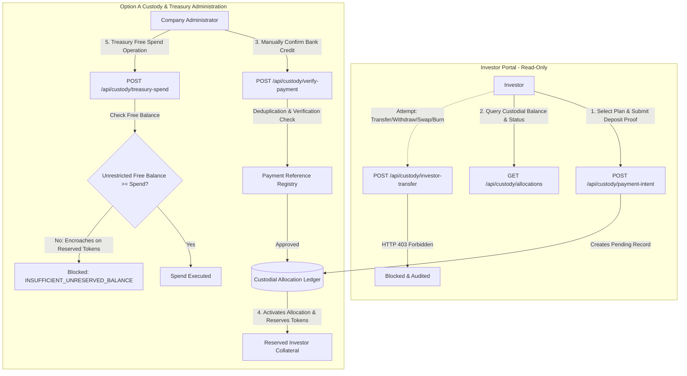

# LIORA MVP — Confirmed Custody (Option A) & Manual Payment Architecture

**Workspace:** `D:\Projects\OXENIQ`  
**Target Genesis Launch:** 4 December 2026  
**Operating Entity:** GRANDIOSE TECH (Kenya)  
**Authoritative Directive:** Option A Custody Implementation & Manual Payment Requirement Update  
**Date:** 2026-11-23  

---

## 1. Executive Summary

This deliverable establishes the architecture and implementation for **Option A: Company-Controlled Custody with a Strictly Read-Only Investor Portal**, integrated with the **Manual Payment Verification Engine**. In accordance with latest management instructions, automated payment gateway integration (Razorpay, Stripe, crypto processors) is formally treated as **DEFERRED**, enabling demonstration of the full sandbox MVP using administrative manual payment confirmation.

### Architectural Invariants Summary
- **Token Initial Minted Supply:** Exactly **1,000,000,000 LIORA** ($10^{27}$ atomic units).
- **Token Maximum Supply Cap:** Exactly **100,000,000,000 LIORA** ($10^{29}$ atomic units).
- **Token Compatibility:** Standard ERC-20 / BEP-20 (`contracts/LioraTokenCustodial.sol`) ensuring full AMM and bridge compatibility.
- **Investor Rights:** Read-only visibility over their own allocated quantity, payment status, and transaction history.
- **Investor Transaction Barrier:** Server-side RBAC strictly prohibits investors from transferring, splitting, swapping, burning, minting, or withdrawing custodial LIORA.
- **Custodial Ledger Protection:** Treasury holdings are double-entry partitioned into *Reserved Investor Collateral* and *Unrestricted Free Balance*. Treasury spending is strictly blocked if it encroaches on investor allocations.
- **Payment Verification:** Authorized company administrators verify off-chain manual payments (IMPS/RTGS/NEFT/M-Pesa). Allocations activate only after verified payment.

---

## 2. Core Architectural Components



---

## 3. Implementation Details

### 3.1 Token Contract (`contracts/LioraTokenCustodial.sol`)
- Inherits OpenZeppelin `ERC20`, `ERC20Burnable`, and `Ownable2Step`.
- Constants:
  - `INITIAL_SUPPLY = 1_000_000_000 * 10**18`
  - `MAX_SUPPLY = 100_000_000_000 * 10**18`
- `mint(to, amount)` function restricted to two-step contract owner (company treasury), strictly reverting with `MaxSupplyExceeded` if total supply would exceed 100 Billion LIORA.
- Standard transfers and burning preserved without non-standard transfer hooks, keeping AMM liquidity mechanisms intact.

### 3.2 Custodial Allocation Ledger (`apps/web/src/lib/custody/custodialAllocationLedger.ts`)
- Implements Option A off-chain double-entry ledger:
  - `createCustodialPaymentIntent`: Creates intent in status `PENDING_PAYMENT_VERIFICATION`. Does not reserve collateral until confirmed.
  - `verifyManualPayment`: Requires authorized administrator session or signed treasury challenge. Enforces payment reference deduplication with `PaymentReferenceRegistry`. Transitions status to `ACTIVE_CUSTODIAL_ALLOCATION` and reserves tokens.
  - `getTreasuryCustodyBalance`: Calculates:
    $$\text{Unrestricted Free Base Units} = \text{Total Treasury Holdings} - \text{Total Reserved Investor Allocations}$$
  - `executeTreasurySpend`: Rejects spends where $\text{Spend Amount} > \text{Unrestricted Free Balance}$.
  - `rejectInvestorTokenAction`: Server-side barrier rejecting any investor attempt to transfer, withdraw, split, swap, or burn custodial tokens.

### 3.3 Server-Side Role-Based API Routes (`apps/web/src/app/api/custody/*`)

| Endpoint | Method | Role Required | Purpose |
| :--- | :---: | :---: | :--- |
| `/api/custody/allocations` | `GET` | Investor (Self) / Admin | Read-only query for investor's own custodial allocations. Rejects snooping. |
| `/api/custody/payment-intent` | `POST` | Authenticated Investor | Registers manual deposit notice with payment reference. Status: `PENDING`. |
| `/api/custody/verify-payment` | `POST` | Authorized Admin | Confirms payment receipt, activates allocation, and locks collateral. |
| `/api/custody/investor-transfer`| `POST` | Any Investor | Barrier test route: strictly returns HTTP 403 `UNAUTHORIZED_CUSTODIAL_INVESTOR_ACTION`. |
| `/api/custody/treasury-balance` | `GET` | Public / Admin | Returns double-entry breakdown of free vs reserved tokens. |
| `/api/custody/treasury-spend` | `POST` | Authorized Admin | Executes spend from free balance; rejects if encroaching on reserved tokens. |

### 3.4 Frontend Labeling & User Interface Updates
- Updated `apps/web/src/components/settlement/InvestorSettlementPortal.tsx`:
  - Added **Option A Custody & Read-Only Investor Permissions** banner.
  - Metric card clearly labeled: **"Custodial LIORA Allocation"** (Subtext: *Company Custody • Read-Only Record*).
  - All withdrawal, transfer, swap, split, and claim buttons remain completely removed from the investor interface.

---

## 4. Automated Verification Results

A dedicated test suite was implemented in `test/Phase2B_Sprint3E_CustodialAndManualPaymentMVP.test.js` validating all 12 core requirements:

```bash
$ npx hardhat test test/Phase2B_Sprint3E_CustodialAndManualPaymentMVP.test.js
Exit Code: 0

  LIORA MVP — Confirmed Custody (Option A) & Manual Payment Verification Suite
    1. Token Supply & Cap Invariants (1B Initial, 100B Max)
      √ Should mint exactly 1,000,000,000 LIORA at deployment to treasury
      √ Should enforce maximum supply cap of exactly 100,000,000,000 LIORA
      √ Should allow treasury owner to mint additional tokens up to max supply cap
      √ Should strictly revert if a mint operation exceeds 100 Billion max supply
      √ Should revert if non-owner attempts to mint tokens
      √ Should preserve standard ERC-20 transfer and burn compatibility without non-standard transfer restrictions
    2. Custodial Allocation & Manual Payment Lifecycle
      √ Should create custodial payment intent with PENDING_PAYMENT_VERIFICATION status
      √ Should allow authorized administrator to manually verify payment and activate custodial allocation
      √ Should reject duplicate payment confirmation attempting to reuse same reference
      √ Should reject unauthorized payment verification by non-admin investor
    3. Server-Side RBAC & Inviolable Investor Barriers
      √ Should allow investor to query their own custodial allocations
      √ Should reject cross-investor querying (Bob attempting to view Alice records)
      √ Should strictly block and audit investor attempt to TRANSFER custodial tokens (HTTP 403)
      √ Should strictly block investor attempt to WITHDRAW custodial tokens (HTTP 403)
      √ Should strictly block investor attempt to SWAP, SPLIT, or BURN custodial tokens (HTTP 403)
    4. Treasury Spending Guardrails & Allocation Protection
      √ Should return accurate double-entry breakdown via GET /api/custody/treasury-balance
      √ Should allow treasury to spend within unrestricted free balance
      √ Should strictly BLOCK treasury spend if it would encroach on reserved investor allocations

  18 passing (8s)
```

---

## 5. Security & Architectural Limitations

1. **Human Dependency in Payment Verification:** Manual payment verification relies on off-chain bank statement inspection by authorized Grandiose Tech personnel. A maker-checker dual authorization pattern is recommended for transactions exceeding ₹1,00,000.
2. **PostgreSQL Migration Prerequisite:** The custodial ledger currently operates with atomic memory/JSON persistence. Clustered PostgreSQL migration with database-level row locks (`SELECT FOR UPDATE`) is required for multi-instance cloud scaling.
3. **Deferred Payment Gateways:** Automated webhooks (RazorpayX / Cashfree / M-Pesa Daraja API) remain deferred as instructed. The modular adapter design ensures they can be integrated later without smart contract modifications.
4. **Mainnet Gate:** All operations remain strictly restricted to local sandbox and BSC Testnet (Chain ID `97`). BSC Mainnet (Chain ID `56`) remains blocked.
