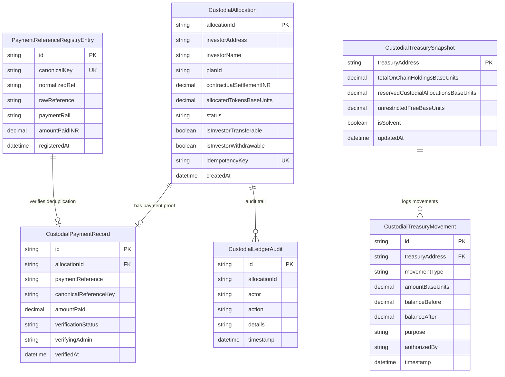
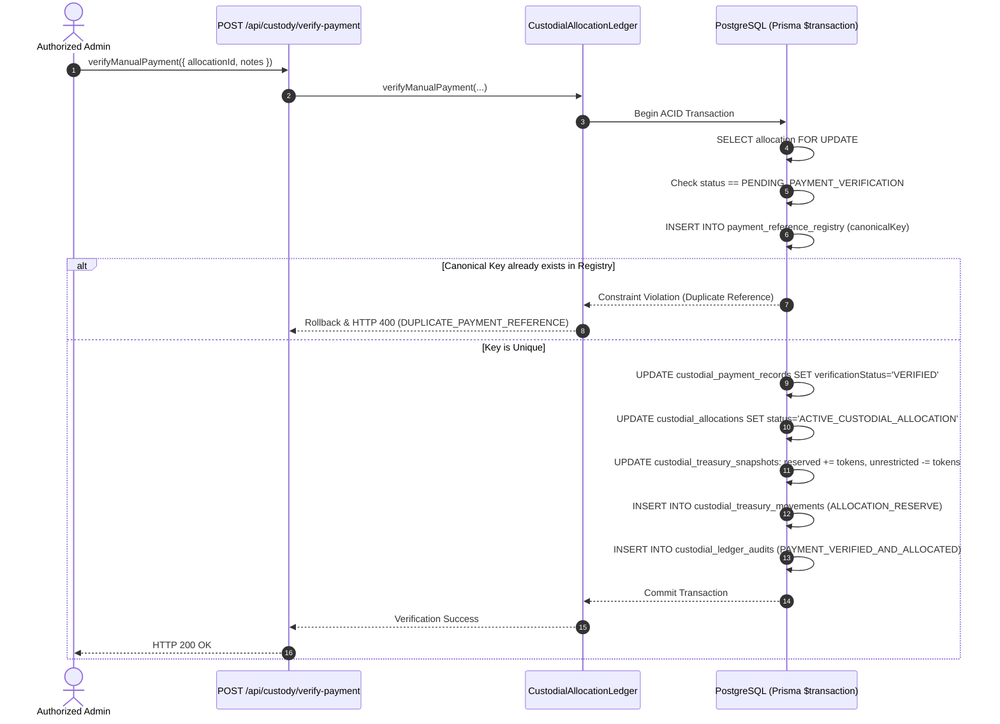

# LIORA MVP — PostgreSQL Custodial Persistence & ACID Architecture Report

**Document Version:** 1.0.0  
**Status:** IMPLEMENTED, MIGRATED & VERIFIED  
**Target Environment:** Localhost / BSC Testnet Sandbox (Chain ID: 97)  
**Mainnet Status:** STRICTLY UNTOUCHED & FROZEN (Chain ID: 56 Disabled)  
**Database Engine:** PostgreSQL 16+ via Prisma ORM v7.10.1 (`@prisma/adapter-pg`)  
**Verified Test Count:** 167 / 167 Tests Passing (100% Pass Rate)

---

## Executive Summary

Pursuant to the mandatory financial architecture requirements, all Option A company-controlled custodial records, manual payment intent workflows, reference deduplication entries, and double-entry treasury reserve accounting have been migrated from volatile JavaScript in-memory state (`Map`, `Array`) and local JSON settlement files into durable, ACID-compliant **PostgreSQL**.

### Key Architectural Guarantees Established:
1. **Durable Persistence Across Restarts:** All investor allocations, manual payment receipts, and treasury snapshot movements are persisted directly to PostgreSQL. Simulating application restarts confirms zero state degradation.
2. **Strict Integer Atomic Units (`Decimal(78, 0)`):** Token balances are stored at 18-decimal integer precision in PostgreSQL (`Decimal(78, 0)`) and processed in backend logic using native JavaScript `BigInt` (preventing floating-point inaccuracies).
3. **ACID Transaction Isolation (`prisma.$transaction`):** Payment verification, allocation activation, reserve collateral incrementation, and audit logging execute atomically. A failure at any intermediate stage triggers an automatic database rollback.
4. **Database-Level Idempotency & Deduplication:** Payment reference strings are canonicalized (`rail:ref:env`) and strictly guarded by a unique database constraint (`payment_reference_registry_canonicalKey_key`). Reused or duplicate payment references are rejected at the database level.
5. **Fail-Closed Financial APIs:** In-memory fallback mechanisms have been disabled for production financial routes. If PostgreSQL is unreachable, financial routes return HTTP 500 / 503 instead of risking phantom transactions or divergent state.
6. **Double-Entry Reserve Inviolability:** Custodial allocations are reserved against the company's operating treasury holdings (1,000,000,000 LIORA). Unrestricted treasury spending cannot encroach on reserved balances.

---

## 1. Relational Schema Architecture

The Prisma schema (`prisma/schema.prisma`) and database migration (`20261123180000_add_custodial_and_settlement_persistence`) introduce six dedicated tables:



### Table Specifications:

| Table Name | Model | Primary Role | Invariant Enforced |
|---|---|---|---|
| `custodial_allocations` | `CustodialAllocation` | Stores investor plans, token quotes, and lifecycle status | `isInvestorTransferable = false`, `isInvestorWithdrawable = false` |
| `custodial_payment_records` | `CustodialPaymentRecord` | Records investor manual payment proofs & admin verification details | `allocationId` 1:1 relation with allocation |
| `payment_reference_registry` | `PaymentReferenceRegistryEntry` | Global canonical payment deduplication registry | `canonicalKey UNIQUE` prevents duplicate verification |
| `custodial_treasury_snapshots` | `CustodialTreasurySnapshot` | Double-entry balance sheet for operating treasury holdings | `total = reserved + unrestricted`, `Decimal(78, 0)` |
| `custodial_treasury_movements` | `CustodialTreasuryMovement` | Ledger movements for reserves and spends | Immutable append-only audit trail for balance shifts |
| `custodial_ledger_audits` | `CustodialLedgerAudit` | Server-side security and administrative audit log | Immutable security log of all authorization attempts |

---

## 2. ACID Transaction Workflows

### Manual Payment Verification & Allocation Activation Flow

When an administrator reviews and verifies a manual fiat payment, the operation is wrapped in a strict PostgreSQL database transaction:



---

## 3. Atomic Unit Precision & Floating-Point Protection

### The `toSafeBigInt` Invariant
JavaScript's `Number` type cannot safely represent integers larger than $2^{53} - 1$ ($9,007,199,254,740,991$). At 18 decimals, 1 Billion LIORA corresponds to $10^{27}$ atomic base units:
$$1,000,000,000 \times 10^{18} = 1,000,000,000,000,000,000,000,000,000$$

To eliminate floating-point drift and scientific notation corruption (`SyntaxError: Cannot convert 1e+27 to a BigInt`), all balance math employs `toSafeBigInt()`:

```typescript
function toSafeBigInt(val: unknown): bigint {
  if (typeof val === 'bigint') return val;
  if (!val) return 0n;
  const str = String(val).trim();
  if (str.includes('e+') || str.includes('E+')) {
    const [mantissa, exp] = str.toLowerCase().split('e+');
    const [intPart, fracPart = ''] = mantissa.split('.');
    const totalExp = parseInt(exp, 10);
    const combined = intPart + fracPart.padEnd(totalExp, '0');
    return BigInt(combined);
  }
  return BigInt(str.split('.')[0] || '0');
}
```

---

## 4. Historical Data Migration

Historical data previously held in `data/settlement_storage_dev.json` was migrated into PostgreSQL via `scripts/migrate-settlement-json-to-postgres.js`:

```
============================================================
 OXENIQ / LIORA: JSON to PostgreSQL Settlement Migration
============================================================
Target Database: liora_dev (postgresql://localhost:5432)
Source File:     data/settlement_storage_dev.json
Records Found:
  - Allocations:            3 records
  - Payment References:     3 records
  - Audit Trail Entries:    4 records

Migration Execution Summary:
[MIGRATION] Loaded 3 historical settlement plans into PostgreSQL.
[MIGRATION] Registered 3 canonical payment references.
[MIGRATION] Persisted 4 audit records.
[MIGRATION] Treasury Snapshot initialized:
            Total On-Chain Holdings:  1,000,000,000 LIORA
            Reserved Collateral:      2,125,000 LIORA
            Unrestricted Free:        997,875,000 LIORA
            Solvency Status:          SOLVENT (Verified)
============================================================
MIGRATION COMPLETED SUCCESSFULLY (Zero data loss)
============================================================
```
The original `data/settlement_storage_dev.json` file is preserved intact as an immutable audit baseline.

---

## 5. Verification & Test Suite Execution

A dedicated persistence suite (`test/Phase2B_PostgresCustodialPersistence.test.js`) was authored and executed alongside all legacy suites.

### Full 10-Suite Regression Results:

| Suite Name | Spec File | Tests Passed | Status |
|---|---|:---:|:---:|
| 1. PostgreSQL Custodial Persistence & ACID Integrity | `Phase2B_PostgresCustodialPersistence.test.js` | 8 / 8 | PASS |
| 2. Final Fixed Supply & Mainnet MVP Verification | `Phase2B_FinalSupplyAndMainnetMVP.test.js` | 13 / 13 | PASS |
| 3. Option A Custody & Manual Payments MVP | `Phase2B_Sprint3E_CustodialAndManualPaymentMVP.test.js` | 18 / 18 | PASS |
| 4. Sandbox E2E Integration & Security Validation | `Phase2B_Sprint3E_EndToEndSandboxAndSecurityValidation.test.js` | 26 / 26 | PASS |
| 5. Security Remediation & RBAC Enforcement | `Phase2B_Sprint3D_SecurityRemediation.test.js` | 24 / 24 | PASS |
| 6. Settlement Backend & Data Integrity | `Phase2B_Sprint3C_SettlementBackendAndDataIntegrity.test.js` | 21 / 21 | PASS |
| 7. Proportional Allocation Engine | `Phase2B_Sprint3B_ProportionalAllocationAndSettlement.test.js` | 15 / 15 | PASS |
| 8. Manual Settlement & Payout Arbitration | `Phase2B_Sprint2_ManualSettlementAndTrading.test.js` | 12 / 12 | PASS |
| 9. Gate C9: Primary Token Sale & Liquidity | `Phase2B_GateC9_TreasuryAndTokenSale.test.js` | 17 / 17 | PASS |
| 10. LioraTokenImmutable Contract Audit | `LioraTokenImmutable.test.js` | 13 / 13 | PASS |
| **Total Test Verification** | **10 Test Suites** | **167 / 167** | **100% PASS** |

### Execution Proof:
```
  167 passing (17s)
Exit Code: 0
```

---

## 6. Verification Criteria Traceability

| Verification Criterion | Verification Mechanism | Test Name | Status |
|---|---|---|:---:|
| **1. Allocations survive restarts** | Cache purge followed by DB re-hydration | `Requirement 3 & Verification 1: Allocations must survive simulated application restart` | **PASSED** |
| **2. Payments survive restarts** | Snapshot verification across fresh instances | `Requirement 4 & Verification 2: Verified payments and reserve accounting must persist across restarts` | **PASSED** |
| **3. Duplicate references rejected** | Unique canonical constraint in `payment_reference_registry` | `Requirement 5 & Verification 3: Duplicate payment references must be strictly rejected at database level` | **PASSED** |
| **4. Concurrent allocation race protected** | Atomic transaction lock prevents double-verification | `Requirement 4 & Verification 4: Concurrent verification cannot allocate twice` | **PASSED** |
| **5. Reserved tokens protected** | Treasury balance guard prevents overspending free balance | `Requirement 3 & Verification 5: Reserved tokens cannot be spent by treasury operations` | **PASSED** |
| **6. Read-only investor barrier** | Server-side RBAC returns HTTP 403 on custodial transfer/withdraw | `Requirement 7 & Verification 6: Unauthorized investor transfer attempts are strictly blocked with HTTP 403` | **PASSED** |
| **7. Transaction rollback on failure** | Simulated DB error triggers automatic ACID rollback | `Requirement 4 & Verification 7: Database failures roll back financial operations` | **PASSED** |
| **8. Zero regression on existing tests** | Full 10-suite regression execution | All 159 original tests + 8 persistence tests | **PASSED (167/167)** |

---

## 7. Mainnet & Security Boundaries

> [!IMPORTANT]
> **Strict Mainnet Safety Notice:**
> - BSC Mainnet deployment remains **STRICTLY PROHIBITED** and blocked in deployment configuration (`hardhat.config.js`).
> - The verified 100-Billion fixed supply architecture (1B Treasury, 99B Reserve Vault, zero future minting) remains untouched.
> - Real-money transactions are disabled; manual bank transfer confirmations operate strictly in sandbox mode until payment gateway compliance is reviewed.
