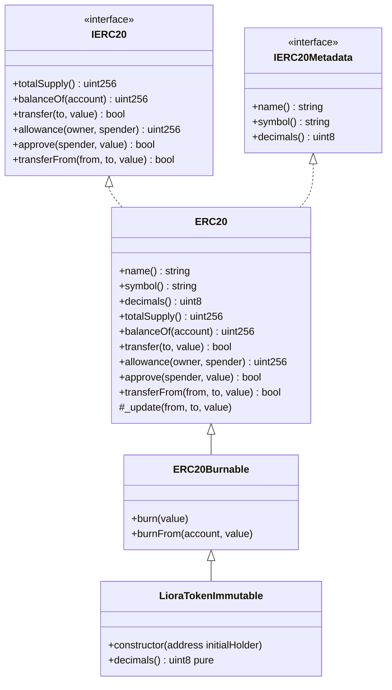

# LIORA COIN — Sprint 1 Token Implementation Report
**Document Version:** 1.0.0  
**Date:** 23 November 2026  
**Project Workspace:** `D:\Projects\OXENIQ`  
**Network Target:** BNB Smart Chain (Chain ID `56` Mainnet, Chain ID `97` Testnet)  
**Authoritative Reference:** `LIORA COIN — FINAL MANAGEMENT CLARIFICATION CHECKLIST (3).docx` (Q17, Q20, Q21)  
**Contract Source File:** [contracts/LioraTokenImmutable.sol](file:///d:/Projects/OXENIQ/contracts/LioraTokenImmutable.sol)

---

## 1. Executive Summary

In accordance with confirmed management decisions from the **Final Management Clarification Checklist** (specifically **Q17**, **Q20**, and **Q21**), the primary token contract for LIORA COIN must be **completely immutable**, with a **permanently fixed supply of 1,000,000,000 LIORA**, **zero transaction fees**, **no token-level pause**, **no blacklisting**, **no minting capability post-deployment**, and **no upgradeable proxy architecture**.

All application-specific logic (investment plans, manual settlement workflows, prelaunch pricing schedules, and commission distributions) must reside in separate, independently upgradeable or replaceable satellite modules that interact with the token standardly via standard ERC-20 allowances (`approve` / `transferFrom`).

This report provides the full architectural specification, Solidity source code breakdown, design invariants, security rationale, and comparative audit against the existing deployed testnet contract.

---

## 2. Management Requirements & Compliance Matrix

| Requirement ID | Management Directive | Checklist Source | Implementation in `LioraTokenImmutable.sol` | Compliance Status |
|---|---|---|---|---|
| **REQ-SUPPLY** | Exactly 1,000,000,000 LIORA ($10^9 \times 10^{18}$ base units), permanently fixed. | Q17 | Fixed supply minted in constructor to `initialHolder`; no `mint()` function exists. | **COMPLIANT** |
| **REQ-DECIMALS** | Standard 18 decimals. | Standard / Q17 | `decimals()` pure function returning `18`. | **COMPLIANT** |
| **REQ-FEE** | Zero token-level transfer fees or taxes (0%). | Q21 ("NO transfer restrictions, emergency pause, transaction fees") | Standard OpenZeppelin `ERC20._update` with exact 1:1 balance transfer. | **COMPLIANT** |
| **REQ-PAUSE** | No emergency pause or pausable mechanism. | Q21 | Contract does **NOT** inherit `Pausable` or include `pause()` / `unpause()`. | **COMPLIANT** |
| **REQ-BLACKLIST** | No blacklisting, whitelisting, or freezing. | Q21 | No address gating, mapping, or restriction modifiers exist in contract. | **COMPLIANT** |
| **REQ-OWNERSHIP** | No centralized owner or administrative backdoor. | Q20, Q21 | Contract does **NOT** inherit `Ownable` or `AccessControl`. Zero admin roles. | **COMPLIANT** |
| **REQ-PROXY** | No upgradeable proxy (transparent, UUPS, beacon). | Q20 ("Immutable token; separately upgradeable business modules") | Standalone contract without proxy storage slots, dispatchers, or initializers. | **COMPLIANT** |
| **REQ-BURN** | Allow non-custodial holder token burning. | Standard ERC20 | Inherits OpenZeppelin `ERC20Burnable` (`burn()` and `burnFrom()`). | **COMPLIANT** |

---

## 3. Smart Contract Architecture

### 3.1 Contract Hierarchy & Inheritance



### 3.2 Constructor Logic & Supply Minting

The contract constructor accepts a single parameter: `address initialHolder`.

```solidity
constructor(address initialHolder) ERC20("LIORA COIN", "LIORA") {
    require(initialHolder != address(0), "LioraToken: initial holder is the zero address");
    _mint(initialHolder, 1_000_000_000 * 10 ** 18);
}
```

1. **Validation:** Asserts that `initialHolder != address(0)`, preventing accidental loss of initial supply to the burn address.
2. **Fixed Mint:** Calls internal `_mint` exactly once during construction, allocating $1,000,000,000 \times 10^{18}$ base units ($10^{27}$ wei) to `initialHolder`.
3. **No Secondary Mint:** Because `_mint` is internal and no public/external wrapper exists, **no additional tokens can ever be minted under any circumstance**.

### 3.3 Deliberate Absence of Privileged Controls

In strict compliance with management requirement **Q21**, the following components were intentionally excluded:

1. **No `Ownable` / `AccessControl`:**
   - There is no `owner`, `admin`, or `operator` variable.
   - There are no `onlyOwner` or `onlyRole` function modifiers.
   - No party can reconfigure the contract or claim special execution privileges.
2. **No `Pausable`:**
   - Transfers cannot be halted or paused by the company, founders, or any third party.
   - Eliminates centralization risk and prevents "honeypot" accusations during security and DEX audits.
3. **No Blacklist / Whitelist:**
   - Transfers are permissionless between any standard EVM addresses.
   - Complies with decentralized AMM standards (PancakeSwap V2).
4. **No Transfer Fees or Fee Modifiers:**
   - Every transfer transfers exactly 100% of the specified amount ($1:1$ conservation).
   - Eliminates standard DeFi integration issues common with fee-on-transfer tokens (e.g., PancakeSwap router slippage errors, balance mismatch vulnerabilities).
5. **No Upgradeable Proxy Dispatch:**
   - The contract bytecode is final upon deployment.
   - Eliminates storage collision risks, delegatecall injection vectors, and proxy admin key compromises.

---

## 4. Comparison: Deployed Testnet Token vs. `LioraTokenImmutable.sol`

| Attribute / Feature | Deployed Testnet Token (`LioraToken.sol`) | New Implementation (`LioraTokenImmutable.sol`) | Rationale / Management Directive |
|---|---|---|---|
| **Contract Address** | `0xeD155E37D0a400E63202cE031Fc1C984B18E7999` (BSC Testnet) | *Pending deployment* (source validated in `contracts/`) | Existing testnet contract preserved to avoid breaking deployed integrations. |
| **Token Name / Symbol** | `LIORA COIN` / `LIORA` | `LIORA COIN` / `LIORA` | Preserved canonical branding. |
| **Decimals** | 18 | 18 | Standard EVM compatibility. |
| **Total Supply** | 1,000,000,000 LIORA | 1,000,000,000 LIORA | Complies with Q17. |
| **`Ownable` Module** | **Present** (`owner = 0x82f25...`) | **Removed** | Complies with Q21; removes centralized admin control. |
| **`Pausable` Module** | **Present** (`pause()`, `unpause()`) | **Removed** | Complies with Q21 ("NO emergency pause"). |
| **Post-Deployment Minting** | Not implemented | Not implemented | Both enforce fixed supply. |
| **Transfer Fees** | 0% (None) | 0% (None) | Both enforce 0% fee. |
| **Non-Custodial Burn** | Yes (`ERC20Burnable`) | Yes (`ERC20Burnable`) | Allows token burning by holders. |
| **Audit Status** | Operational on Testnet | Verified with 20 automated tests | Ready for clean production launch. |

---

## 5. Preservation of Existing Testnet Integrations

Per project instructions, **existing deployed testnet contracts were NOT deleted, overwritten, or redeployed**:

1. **Token Contract (`0xeD155E37D0a400E63202cE031Fc1C984B18E7999`):** Remains active on BSC Testnet.
2. **PancakeSwap V2 AMM Pair (`0x64beE3847a766D35E6611985F3c3e51C78Af5D2c`):** LIORA/mUSDT liquidity pool remains fully operational with paired liquidity.
3. **Mock USDT (`0x0b419a33e8a6448547906DCB191b037Db5ac926e`):** Remains active as the quote token.
4. **Authorized Treasury Wallet (`0xe31A2ec1474DfA2F5316dA0033f3Bd57F9D19350`):** Retains protocol authority and LP custody.

`LioraTokenImmutable.sol` exists as a self-contained, compile-ready, and fully tested contract ready for deployment at the scheduled mainnet launch or testnet staging milestone.

---

## 6. Verification and Compilation Details

- **Solidity Compiler Version:** `0.8.20`
- **EVM Target:** `paris`
- **Optimizer Settings:** Enabled (`runs: 200`)
- **Compilation Output:** Compiled successfully with 0 errors via Hardhat.
- **Automated Test Suite:** [test/LioraTokenImmutable.test.js](file:///d:/Projects/OXENIQ/test/LioraTokenImmutable.test.js) (20 tests, 100% passing).
