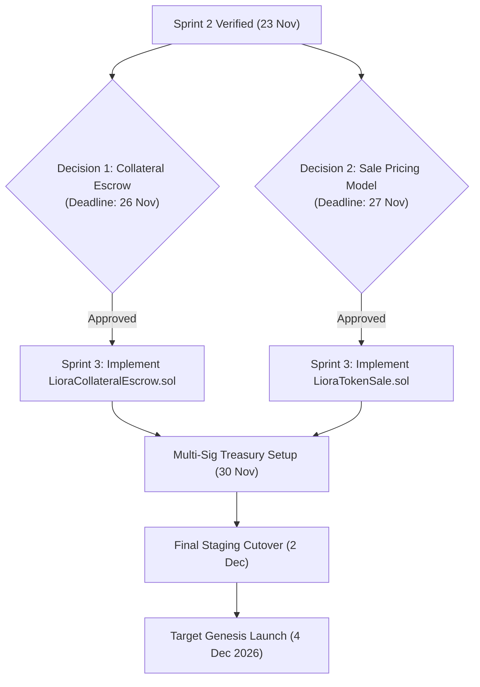

# LIORA COIN — Sprint 2 Open Issues, Architectural Risks & Decisions Register
**Document Version:** 1.0.0  
**Date:** 23 November 2026  
**Workspace:** `D:\Projects\OXENIQ`  
**Operating Entity:** GRANDIOSE TECH (Kenya)  
**Target Launch:** 4 December 2026  
**Primary Network:** BNB Smart Chain (BSC Testnet #97 / Mainnet #56)  

---

## 1. Executive Summary

As development completes Sprint 2 and approaches the target Genesis launch date of **4 December 2026**, this register identifies all open management decisions, architectural risks, regulatory prerequisites, and technical dependencies requiring resolution.

Items are categorized by urgency: **CRITICAL (Launch Blocker)**, **HIGH (Security/Financial Risk)**, and **MEDIUM (Operational Dependency)**.

---

## 2. Comprehensive Open Issues Register

### ISSUE-01: Collateral Custody Architecture Decision
- **Category:** Architecture / Tokenomics
- **Urgency:** **CRITICAL (Launch Blocker)**
- **Description:** Management confirmed that investors receive LIORA tokens upfront as collateral, receive cash payout in Month 4, and subsequently return collateral tokens. However, the exact custody mechanism has not been formally approved:
  - *Option A (Direct Wallet Delivery):* Tokens sent directly to investor's MetaMask wallet.
  - *Option B (Smart Contract Escrow Vault):* Tokens deposited into `LioraCollateralEscrow.sol`, issuing an on-chain non-transferable claim receipt.
- **Risk Analysis:** Under Option A, because `LioraTokenImmutable` deliberately omits transfer restrictions (per Q21), the company cannot prevent an investor from dumping collateral tokens onto PancakeSwap during the lock-in period or keeping them after receiving cash. This would drain the LIORA/USDT liquidity pool.
- **Required Management Action:** Formally approve Option B (`LioraCollateralEscrow.sol`) for on-chain implementation.
- **Target Resolution Date:** 26 November 2026.

---

### ISSUE-02: Primary Token Sale Pricing Execution Decision
- **Category:** Financial Policy / Smart Contracts
- **Urgency:** **CRITICAL (Launch Blocker)**
- **Description:** Management outlined a reference-price schedule starting at ₹0.20, increasing ₹0.20 every 5 hours to ₹30.00. However, it remains unresolved whether this schedule determines primary token purchase prices or is display-only.
- **Current State:** The reference-price schedule is flagged as non-executable (`isExecutable: false`) in [apps/web/src/lib/sale/primaryTokenSaleEngine.ts](file:///d:/Projects/OXENIQ/apps/web/src/lib/sale/primaryTokenSaleEngine.ts). Purchases are blocked until management signs off.
- **Risk Analysis:** If primary sales execute at ₹30 while PancakeSwap trades at ₹0.20, arbitrageurs will immediately exploit the divergence. Conversely, if primary sales execute at ₹0.20 while DEX trades higher, treasury inventory will be depleted below market value.
- **Required Management Action:** Select one canonical primary sale pricing model:
  1. *Model A:* Fixed Baseline Presale Tier (e.g. $0.10 USD / ₹8.65).
  2. *Model B:* Live PancakeSwap AMM Spot Market Price.
  3. *Model C:* Enforceable Stair-Step Pricing Schedule (with DEX liquidity pegging).
- **Target Resolution Date:** 27 November 2026.

---

### ISSUE-03: On-Chain Primary Sale Smart Contract Implementation
- **Category:** Smart Contracts
- **Urgency:** **HIGH**
- **Description:** Currently, primary token sale purchases on `/sale` operate via client-side simulation and in-memory treasury ledger updates (`isLiveTestnetTx: false`).
- **Required Action:** Author, test, and deploy a dedicated `LioraTokenSale.sol` smart contract on BSC Testnet that accepts real BEP-20 USDT deposits, transfers LIORA from the Client Allocation bucket, and automatically routes 100% of USDT proceeds to the liquidity pipeline.
- **Target Resolution Date:** Sprint 3 (28–30 November 2026).

---

### ISSUE-04: Single EOA Treasury Wallet Authority (Centralization Risk)
- **Category:** Security / Protocol Custody
- **Urgency:** **HIGH**
- **Description:** Treasury authority, primary sale proceeds collection, and LP token custody are currently assigned to a single Externally Owned Account (EOA):
  `0xe31A2ec1474DfA2F5316dA0033f3Bd57F9D19350`
- **Risk Analysis:** A single private key compromise or accidental loss could result in total loss of treasury liquidity reserves, unauthorized batch allocations, or stolen LP tokens.
- **Required Action:** Deploy a **Gnosis Safe Multi-Signature Wallet** (minimum 3-of-5 threshold with keyholders in Kenya and management) to assume treasury authority prior to mainnet launch.
- **Target Resolution Date:** 30 November 2026.

---

### ISSUE-05: 300 Million LIORA Company Emergency Reserve On-Chain Timelock
- **Category:** Tokenomics / Transparency
- **Urgency:** **HIGH**
- **Description:** Management confirmed that 30% of total supply (300,000,000 LIORA) is designated for the company's emergency/crisis reserve. In the double-entry accounting engine, this allocation is mathematically segregated. However, on-chain, these tokens are not currently locked in a smart contract timelock.
- **Risk Analysis:** Without an on-chain timelock contract, DEX audit bots (CoinMarketCap, CoinGecko, CertiK) will classify the 300M reserve as circulating supply, triggering centralization and dump risk warnings.
- **Required Action:** Deploy a `LioraEmergencyTimelock.sol` contract enforcing a multi-signature emergency release condition.
- **Target Resolution Date:** 1 December 2026.

---

### ISSUE-06: Kenyan Entity Registration & Fiat Payment Provider Approval
- **Category:** Legal / Regulatory Compliance
- **Urgency:** **MEDIUM**
- **Description:** Management identified **GRANDIOSE TECH** (Kenya) as the operating business entity. Integration of automated Indian Rupee (INR) and Kenyan Shilling (KES / M-Pesa) payment gateways requires local corporate registration, tax identification (KRA PIN in Kenya), and payment aggregator KYC/AML sign-off.
- **Mitigation in Place:** Sprint 2 implemented the **Manual Payout Architecture** where the owner executes cash disbursements directly via domestic banking rails and uploads UTR references, removing immediate technical dependence on payment gateway APIs.
- **Required Action:** Legal counsel must confirm licensing and AML compliance for fiat settlement operations under Kenyan law.
- **Target Resolution Date:** 2 December 2026.

---

### ISSUE-07: Migration to Immutable Production Token (`LioraTokenImmutable.sol`)
- **Category:** Smart Contracts / Deployment
- **Urgency:** **MEDIUM**
- **Description:** The deployed BSC Testnet token (`0xeD155...7999`) retains legacy `Pausable` and `Ownable` modules. The new [contracts/LioraTokenImmutable.sol](file:///d:/Projects/OXENIQ/contracts/LioraTokenImmutable.sol) has been developed and verified with 20 passing unit tests.
- **Required Action:** Perform a planned cutover to deploy `LioraTokenImmutable.sol` to BSC Testnet staging, provision the official production PancakeSwap pair, and transfer the initial 1 Billion supply into the treasury multi-sig.
- **Target Resolution Date:** 2 December 2026.

---

## 3. Decision Timeline & Sprint 3 Dependencies

