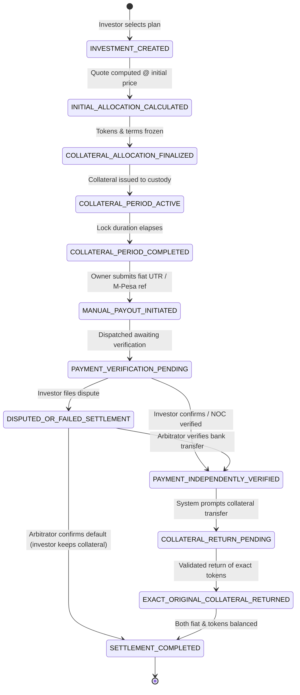

# LIORA COIN — Sprint 3B Manual Settlement Architecture Implementation Report

**Document Version:** 1.0.0  
**Date:** 23 November 2026  
**Workspace:** `D:\Projects\OXENIQ`  
**Operating Entity:** GRANDIOSE TECH (Kenya)  
**Target Genesis Launch:** 4 December 2026  
**Authoritative Baseline:** `LIORA COIN — FINAL MANAGEMENT CLARIFICATION CHECKLIST (3).docx`, supplemented by confirmed manual cash payout and collateral-return arrangement.

---

## 1. Executive Summary

Sprint 3B delivers the updated test-only manual settlement state machine and interface architecture for LIORA COIN.

The implementation formalizes the newly confirmed management clarification:
1. Investors receive LIORA tokens upfront as fixed collateral.
2. The collateral is locked for the plan's agreed term (3 months for Tiers 01–03, 9 months for Tier 04, 12 months for Tiers 05–06).
3. The company owner manually pays the agreed contractual cash amount in the designated payout month (Month 4, 10, or 13).
4. After independent verification of the cash payment, the investor returns **exactly the original allocated collateral quantity** to the company treasury.
5. Both the off-chain fiat settlement evidence and the on-chain collateral return transaction are recorded in an immutable double-entry ledger.

---

## 2. The 12-Stage Settlement State Machine

The settlement lifecycle is governed by a 12-stage state machine designed to prevent unilateral actions, premature collateral seizure, or false payout claims:

### Stage Definitions & Transition Rules:

1. `INVESTMENT_CREATED`: Initial record created upon plan selection.
2. `INITIAL_ALLOCATION_CALCULATED`: Exact proportional token allocation computed via `ProportionalAllocationEngine`.
3. `COLLATERAL_ALLOCATION_FINALIZED`: Original collateral quantity permanently frozen; immutable terms locked.
4. `COLLATERAL_PERIOD_ACTIVE`: Lock-in active for contractual duration (3, 9, or 12 months).
5. `COLLATERAL_PERIOD_COMPLETED`: Lock-in matured; plan enters payout window (Month 4, 10, or 13).
6. `MANUAL_PAYOUT_INITIATED`: Company owner executes off-chain fiat wire and inputs payment rail (IMPS/RTGS/M-Pesa) and reference (UTR).
7. `PAYMENT_VERIFICATION_PENDING`: Dispatched payout awaits investor bank confirmation or independent receipt audit.
8. `PAYMENT_INDEPENDENTLY_VERIFIED`: Cash arrival verified by investor confirmation or bank NOC statement.
9. `COLLATERAL_RETURN_PENDING`: Collateral return is requested from the investor or escrow contract.
10. `EXACT_ORIGINAL_COLLATERAL_RETURNED`: Collateral return transaction verified; validates that returned tokens match the **exact original quantity**.
11. `SETTLEMENT_COMPLETED`: Terminal state; both fiat payout verified and exact collateral returned.
12. `DISPUTED_OR_FAILED_SETTLEMENT`: Freeze state; triggered if investor reports non-receipt of funds or wire reversal.

---

## 3. Strict Safety & Verification Guards

### 3.1 Settlement Not Completed on Payout Dispatch Alone
- A common flaw in centralized systems is marking contracts "complete" when an administrator clicks "Paid".
- In this architecture, owner dispatch only advances the state to `MANUAL_PAYOUT_INITIATED`.
- Calling `returnCollateral` or attempting to close the record while in `MANUAL_PAYOUT_INITIATED` is strictly rejected with `PRECONDITION_FAILED`.

### 3.2 Exact Original Collateral Quantity Enforcement
- When an investor returns collateral, the engine checks:
  $$\text{differenceWei} = \text{returnedBaseUnits} - \text{originalAllocatedBaseUnits}$$
- If `differenceWei !== 0n`, the transaction is rejected with `COLLATERAL_QUANTITY_MISMATCH`.
- Investors cannot return partial collateral or substitute other tokens.

### 3.3 Protection Against Unilateral Collateral Seizure
- The company owner has **no function** to confiscate, burn, or claw back collateral from an investor.
- In the prototype, collateral remains with the investor/escrow until:
  - The investor explicitly verifies cash receipt via `confirmInvestorPayment`, OR
  - An independent arbitrator validates bank NOC evidence after a dispute.

### 3.4 Dispute & Failure Handling
- If an owner enters a fake UTR or the bank wire fails, the investor clicks **Raise Dispute**.
- State transitions to `DISPUTED_OR_FAILED_SETTLEMENT`, freezing any collateral return.
- If the company defaults, arbitration ruling `RESOLVED_COLLATERAL_RELEASED` permanently awards the collateral tokens to the investor and settles the plan.

---

## 4. Off-Chain Fiat Rails & Reconciliation Accounting

The manual settlement engine supports four operational payment rails:
1. `IMPS_BANK_TRANSFER`: Instant domestic bank transfer (India).
2. `RTGS_WIRE`: High-value wire transfer (India).
3. `MPESA_MOBILE_MONEY`: Official corporate mobile remittance (Kenya & East Africa).
4. `USDT_TESTNET_TRANSFER`: Sandbox crypto remittance option.

### Double-Entry Collateral Invariant:
$$\text{Total Collateral Allocated} \equiv \text{Active Collateral Outstanding} + \text{Total Collateral Returned}$$
Every transaction updates the audit log and verifies that:
$$\text{Reconciliation Discrepancy} \equiv 0$$

---

## 5. UI Dashboards Overview

### Investor Settlement Portal (`/settlement` / `/dashboard`)
- Selected Plan name, Tier number, and investment date.
- Principal investment amount (₹ and $).
- Contractual cash settlement due (Fixed).
- Original allocated collateral tokens (Fixed, with `@ ₹Price` disclosure).
- Lock-in duration and expected payout month.
- Interactive controls: **Confirm Bank Payment Received** and **Raise Dispute (Funds Not Received)**.
- Exact collateral return button (active only after payment confirmation).
- Modal displaying full chronological audit history.

### Admin Settlement Console (`/admin`)
- Role-gated to `AUTHORIZED_TREASURY_WALLET`.
- Reconciliation summary cards: Total Liabilities, Active Collateral, Returned Collateral, and Reconciliation Integrity (100% Balanced).
- Full roster of investor records with search and filter tabs (All, Active, Matured, Disputed, Settled).
- **Record Manual Payout Modal**: Inputs for Amount, Payment Rail, UTR/Ref Number, and Admin Notes.
- **Dispute Arbitration Console**: Options to verify bank NOC or confirm company default.
- Full immutable ledger view.
