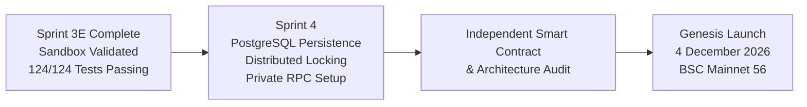

# LIORA COIN — Sprint 3E: Production Readiness & Architectural Blockers Report

**Project Workspace:** `D:\Projects\OXENIQ`  
**Target Genesis Launch:** 4 December 2026  
**Operating Entity:** GRANDIOSE TECH (Kenya)  
**Authoritative Baseline:** `LIORA COIN — FINAL MANAGEMENT CLARIFICATION CHECKLIST (3).docx`  
**Current Milestone:** Sprint 3E Complete  
**Date:** 2026-11-23  

---

## 1. Executive Summary

Sprint 3E successfully validated the complete 12-step investor lifecycle and verified all Sprint 3D security remediations in a controlled sandbox environment. With 124 passing automated tests and zero TypeScript errors, the core logic for proportional allocation, manual fiat payout recording, and exact base-unit collateral return verification is functionally complete and mathematically sound.

However, before any transition to live blockchain deployment on BNB Smart Chain Mainnet (Chain ID `56`) or real-money financial operations, six critical architectural, infrastructure, and operational blockers must be resolved.

---

## 2. Critical Production Blockers Matrix

| Blocker ID | Domain | Category | Description | Severity | Target Milestone |
| :--- | :--- | :--- | :--- | :---: | :---: |
| **BLK-01** | Persistence | Infrastructure | Local JSON file storage must be migrated to clustered PostgreSQL with ACID row locks | **CRITICAL** | Sprint 4 |
| **BLK-02** | Concurrency | Architecture | Single-node in-memory reference registry lacks distributed locking (Redis Redlock) | **HIGH** | Sprint 4 |
| **BLK-03** | Operations | Banking | Manual fiat payout entry relies on off-chain human review without automated bank webhooks | **MEDIUM** | Sprint 4 / Operations |
| **BLK-04** | Blockchain | RPC Node | Testnet collateral verification relies on local simulation; requires dedicated archive RPC | **HIGH** | Sprint 4 |
| **BLK-05** | Governance | Policy | Mandatory segregation of unapproved technical proposals from management baseline | **MANDATORY** | Completed / Maintained |
| **BLK-06** | Deployment | Mainnet Gate | Multi-sig treasury custody, liquidity provisioning, and BscScan verification pending | **CRITICAL** | Pre-Launch Gate |

---

## 3. In-Depth Blocker Analysis

### Blocker BLK-01: Local JSON File Storage (`settlement_storage_dev.json`)
- **Current State:** The settlement system uses `SettlementPersistentStore` reading and writing to `data/settlement_storage_dev.json`. Atomic writes (via temporary file + rename) and corruption backup handling (`.corrupted.{ts}.bak`) were added in Sprint 3D, making it robust for sandbox testing.
- **Production Risk:**
  - Filesystem writes cannot handle horizontal scale across multi-instance server clusters (e.g. AWS ECS, Kubernetes, or Vercel Serverless).
  - High write concurrency could encounter filesystem locks or race conditions.
  - No database transaction isolation levels (Read Committed / Serializable).
- **Required Action:** Migrate `SettlementPersistentStore` to the existing Prisma ORM (`apps/web/src/lib/server/prismaDb.ts`) backed by PostgreSQL, using relational tables (`SettlementInvestment`, `SettlementPayout`, `SettlementAuditLog`) with database foreign keys and row-level locks (`SELECT FOR UPDATE`).

### Blocker BLK-02: Single-Node Concurrency & Distributed Locking
- **Current State:** Payment reference deduplication (`PaymentReferenceRegistry`) and investment ID generation use in-memory state backed by the local JSON file.
- **Production Risk:** If the web application is scaled to multiple container instances, concurrent payouts could process identical reference numbers before the file is flushed, causing race collisions.
- **Required Action:** Implement distributed mutual exclusion (e.g., Redis Redlock or PostgreSQL advisory locks) around `recordManualPayout` and `createInvestment` operations.

### Blocker BLK-03: Manual Fiat Payout Off-Chain Banking Rail Integration
- **Current State:** Administrators manually enter bank transfer references (IMPS UTR, RTGS, M-Pesa receipt) after transferring funds from Grandiose Tech's Nairobi bank account.
- **Production Risk:**
  - Potential human data-entry typo in reference numbers.
  - Delay between bank execution and admin portal recording.
  - Fraud risk if an administrator enters a false reference number without bank verification.
- **Required Action:**
  - Provide a dual-authorization requirement (maker-checker pattern) for manual payouts above ₹1,00,000.
  - Evaluate integration with automated banking webhooks (e.g. Cashfree, RazorpayX, or Kenyan banking APIs) to ingest settlement confirmations programmatically.

### Blocker BLK-04: Dedicated Blockchain Archive RPC for Collateral Verification
- **Current State:** `TestnetCollateralVerifier` currently operates with sandbox fallback mode for testing without a live public testnet connection.
- **Production Risk:** Public BSC Testnet RPC endpoints (`https://data-seed-prebsc-1-s1.binance.org:8545/`) frequently experience rate limits, latency spikes, and blockchain reorganizations, causing transaction verification timeouts.
- **Required Action:** Configure private, authenticated BSC Testnet and Mainnet RPC endpoints with archive capability (e.g. QuickNode, Alchemy, or Ankr) and multi-node failover.

### Blocker BLK-05: Segregation of Unapproved Technical Proposals
- **Current State:** Several technical proposals were previously discussed but not approved by management.
- **Authoritative Management Requirements:**
  - Investors receive LIORA tokens at the beginning as collateral.
  - The company owner calculates and manually pays the agreed cash amount after the lock-in period.
  - For a 3-month plan, payment is made in the 4th month.
  - After receiving the cash payment, the investor returns the collateral tokens to the company.
- **Status of Unapproved Proposals:**
  - *30-Minute Price Quote Lock:* **STRICTLY UNAPPROVED**.
  - *On-Chain Escrow Smart Contract Vault:* **STRICTLY UNAPPROVED**.
  - *Mandatory Investor Frontend Confirmation Gate:* **STRICTLY UNAPPROVED**.
  - *Independent Third-Party Arbitration Council:* **STRICTLY UNAPPROVED**.
- **Requirement:** Maintain strict segregation in all documentation and code. Do not implement these proposals as active business rules.

### Blocker BLK-06: BSC Mainnet Genesis Launch Requirements
- **Target Launch Date:** 4 December 2026.
- **Pre-Launch Checklist:**
  1. **Smart Contract Verification:** Deploy `LioraTokenImmutable.sol` to BSC Mainnet and verify source code on BscScan.
  2. **Fixed Supply Allocation:** Mint exactly 1,000,000,000 LIORA to the designated multi-signature company treasury wallet.
  3. **70:30 Bucket Segregation:** Enforce the 700M client allocation and 300M company emergency reserve accounting buckets.
  4. **PancakeSwap V2 Liquidity Provision:** Execute the initial liquidity provision batch pairing LIORA with USDT on PancakeSwap V2, securing Cake-LP tokens in the company treasury.
  5. **Treasury Custody:** Deploy a Gnosis Safe multi-signature wallet (minimum 3-of-5 threshold) for authorized administrative actions.

---

## 4. Production Readiness Roadmap

---

## 5. Summary Verdict

The software architecture is robust, verified, and free of security regressions. Migration to enterprise database persistence and private RPC infrastructure represents the final engineering hurdle prior to the 4 December 2026 Genesis Launch.
