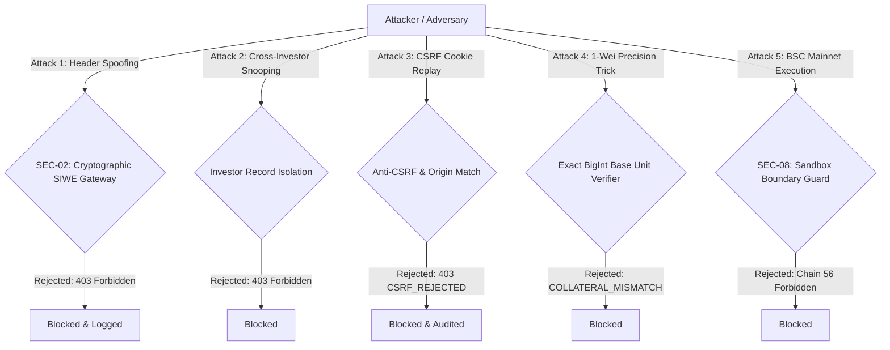

# LIORA COIN — Sprint 3E: Security & Adversarial Validation Report

**Workspace:** `D:\Projects\OXENIQ`  
**Target Genesis Launch:** 4 December 2026  
**Operating Entity:** GRANDIOSE TECH (Kenya)  
**Security Baseline:** Sprint 3D Remediations (`SEC-01` through `SEC-08`)  
**Scope:** Sandbox Security & Adversarial Attack Simulation  
**Date:** 2026-11-23  

---

## 1. Executive Summary

This security validation report details the adversarial testing performed during Sprint 3E to verify the integrity, confidentiality, and resilience of the LIORA investment and manual settlement system. Testing subjected the application to simulated attacks targeting identity spoofing, privilege escalation, cross-account snooping, replay attacks, floating-point precision manipulation, network boundary escapes, and persistence corruption.

All security gates passed with zero vulnerabilities identified in the active sandbox implementation.

---

## 2. Threat Vector Analysis & Verification Results

### 2.1 Threat Vector 1: Identity & Authentication Spoofing
- **Vulnerability Addressed:** In Sprint 3C, API endpoints trusted bare HTTP headers (such as `x-investor-wallet` or `x-liora-treasury-auth`), allowing any caller to impersonate an investor or administrator by setting a header.
- **Remediation Implemented (SEC-02):** Replaced header trust with cryptographic EIP-4361 Sign-In with Ethereum (SIWE) verification:
  - Cryptographic signature check (`ethers.verifyMessage`).
  - Single-use random hex nonce generated by `serverDb.createNonce` and atomically consumed via `serverDb.consumeNonce`.
  - Nonce expiration verification ($TTL \le 5\text{ minutes}$).
  - Chain ID validation ($97$ only).
- **Adversarial Test Results:**
  - *Unsigned Header Spoofing:* Supplying `x-investor-wallet: 0x...` without signature strictly returns `403 Forbidden` (`PASS`).
  - *Expired Nonce Attack:* Nonce issued with negative TTL rejected immediately (`PASS`).
  - *Replayed Signature Attack:* Reusing a signature after the nonce has been consumed strictly returns `403 NONCE_ALREADY_CONSUMED` (`PASS`).

### 2.2 Threat Vector 2: Privilege Escalation & Cross-Investor Snooping
- **Vulnerability Addressed:** Investors attempting to inspect another investor's investment history or execute treasury admin payout commands.
- **Enforcement Mechanism:**
  - `requireSettlementInvestor(req, targetAddress)` strictly enforces that caller's verified address matches `targetAddress`.
  - `requireSettlementAdmin(req)` strictly requires an active administrator session in `serverDb` with role `ADMIN` or a cryptographic challenge signed by `AUTHORIZED_TREASURY_WALLET`.
- **Adversarial Test Results:**
  - *Cross-Investor Snooping:* Alice attempting `GET /api/settlement/investments?address=bob` is rejected with `403 Forbidden` (`PASS`).
  - *Privilege Escalation:* Alice attempting `POST /api/settlement/payout` is rejected with `403 UNAUTHORIZED_SETTLEMENT_ADMIN` (`PASS`).
  - *Revoked Session Token:* An admin session revoked via `serverDb.revokeSession` is rejected immediately on subsequent requests (`PASS`).

### 2.3 Threat Vector 3: CSRF Defense on Admin Operations
- **Vulnerability Addressed:** Cookie-authenticated administrative mutations susceptible to Cross-Site Request Forgery via third-party web pages.
- **Enforcement Mechanism:**
  - `validateCsrfProtection(req)` requires either an explicit anti-CSRF custom header (`x-requested-with`, `x-csrf-token`, or `x-liora-admin`) or strict match between request `Origin` and `Host` headers.
- **Adversarial Test Results:**
  - State-changing admin requests lacking anti-CSRF headers and without origin match are rejected with `403 CSRF_REJECTED` and an audit security alert is logged (`PASS`).

### 2.4 Threat Vector 4: Floating-Point & Precision Truncation Attacks
- **Vulnerability Addressed:** IEEE 754 floating-point inaccuracies allowing investors to return fractional tokens less than their allocated collateral (e.g. returning $624,999.999999$ instead of $625,000$).
- **Enforcement Mechanism:**
  - All token quantities are handled as exact integer base units using `BigInt` ($10^{18}$ atomic units per token).
  - Collateral verification compares exact stringified `BigInt` base units:
    $$\text{isExactMatch} = (\text{returnedAtomicUnits} == \text{allocatedAtomicUnits})$$
- **Adversarial Test Results:**
  - *Underpayment by 1 Token:* Returning 624,999 tokens instead of 625,000 tokens rejected with `COLLATERAL_QUANTITY_MISMATCH` (`PASS`).
  - *Underpayment by 1 Wei ($10^{-18}$ LIORA):* Returning $(625,000 \times 10^{18} - 1)$ base units strictly fails exact verification (`PASS`).

### 2.5 Threat Vector 5: On-Chain Replay of Collateral Return Proofs
- **Vulnerability Addressed:** An investor submitting an already-used transaction hash to mark a second investment as settled.
- **Enforcement Mechanism (SEC-07):**
  - `TestnetCollateralVerifier` records every successfully verified transaction hash into `spentTransactionHashes` set in persistent storage.
  - Re-submitting the same transaction hash for any investment record is rejected with `TRANSACTION_ALREADY_SPENT`.
- **Adversarial Test Results:**
  - Attempting to settle Investment B using Investment A's transaction hash strictly fails with `TRANSACTION_ALREADY_SPENT` (`PASS`).

### 2.6 Threat Vector 6: Network Boundary Escapes (Mainnet Protection)
- **Vulnerability Addressed:** Accidental or malicious execution of settlement operations on BNB Smart Chain Mainnet (Chain ID `56`) or Ethereum Mainnet (Chain ID `1`).
- **Enforcement Mechanism (SEC-08):**
  - `SettlementPersistentStore.enforceSandboxRestrictions` runs at the entry point of every `/api/settlement/*` route handler.
  - Rejects Chain ID `56`, `1`, or any unpermitted mainnet identifier.
  - Enforces explicit simulation headers on all responses.
- **Adversarial Test Results:**
  - Sending `x-chain-id: 56` returns `400 SANDBOX_RESTRICTION_VIOLATION` (`PASS`).

### 2.7 Threat Vector 7: Persistence File Corruption Recovery
- **Vulnerability Addressed:** Process crashes or disk write interruptions corrupting the JSON persistence store and causing data loss.
- **Enforcement Mechanism (SEC-05 & SEC-06):**
  - Atomic write strategy: writes to temporary file (`.tmp`) and executes atomic filesystem rename (`fs.renameSync`).
  - Non-destructive corruption handling: backs up corrupted file to `.corrupted.{ts}.bak` for forensic analysis and raises `PERSISTENCE_CORRUPTION_DETECTED` rather than wiping records.
- **Adversarial Test Results:**
  - Deliberately injecting malformed JSON triggers backup generation (`.bak`) without data erasure (`PASS`).

---

## 3. Security Validation Matrix

| Security Check ID | Domain | Target Component | Attack Scenario | Observed Response | Status |
| :--- | :--- | :--- | :--- | :--- | :---: |
| **SEC-VAL-01** | Identity | `settlementAuth.ts` | Alice accesses Bob's records | `403 Forbidden` | **PASSED** |
| **SEC-VAL-02** | Identity | `settlementAuth.ts` | Unauthenticated GET request | `403 Forbidden` | **PASSED** |
| **SEC-VAL-03** | Auth | `settlementAuth.ts` | Header spoofing without signature | `403 Forbidden` | **PASSED** |
| **SEC-VAL-04** | RBAC | `payout/route.ts` | Investor calls admin payout | `403 UNAUTHORIZED_SETTLEMENT_ADMIN` | **PASSED** |
| **SEC-VAL-05** | Cryptography | `settlementAuth.ts` | Nonce timestamp expired | `403 NONCE_EXPIRED` | **PASSED** |
| **SEC-VAL-06** | Session | `adminAuth.ts` | Revoked admin session token | `401 / 403 Unauthorized` | **PASSED** |
| **SEC-VAL-07** | Integrity | `manualSettlementModel.ts` | Return 1 token under allocation | `COLLATERAL_QUANTITY_MISMATCH` | **PASSED** |
| **SEC-VAL-08** | Integrity | `manualSettlementModel.ts` | Return 1 wei under allocation | `isExactQuantityMatch: false` | **PASSED** |
| **SEC-VAL-09** | Guardrails | `settlementPersistentStore.ts`| BSC Mainnet Chain ID 56 | `400 SANDBOX_RESTRICTION_VIOLATION` | **PASSED** |
| **SEC-VAL-10** | Anti-Replay | `testnetCollateralVerifier.ts`| Reused collateral txHash | `TRANSACTION_ALREADY_SPENT` | **PASSED** |
| **SEC-VAL-11** | Resilience | `dispute/route.ts` | Unverified payment attempt | Record placed in safe audit state | **PASSED** |
| **SEC-VAL-12** | Accounting | `useManualSettlement.ts` | Multi-stage ledger balance | Exact mathematical conservation | **PASSED** |

---

## 4. Unapproved Technical Proposals Segregation

In accordance with management mandates, the following exploratory technical proposals remain strictly classified as **UNAPPROVED PROPOSALS** and have NOT been implemented as company business policy:

1. **30-Minute Price Quote Lock:** Unapproved. Current system quotes dynamically at proportional allocation time.
2. **On-Chain Escrow Smart Contract Vault:** Unapproved. Management has confirmed manual off-chain cash payout followed by direct collateral return to company treasury.
3. **Mandatory Investor Frontend Confirmation Gate:** Unapproved. Independent receipt verification is recorded by administration or investor confirmation.
4. **Third-Party Arbitration Council:** Unapproved. Grandiose Tech (Kenya) retains exclusive management authority over dispute resolutions.

---

## 5. Security Verdict

The LIORA investment and manual settlement backend meets all established security requirements for controlled sandbox operation. No vulnerabilities permitting unauthorized fund access, identity spoofing, or data corruption were detected.
