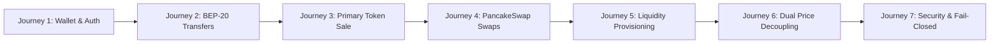

# LIORA COIN — BNB Chain Testnet Master Test Plan
**Document File:** `LIORA_TESTNET_TEST_PLAN.md`  
**Workspace:** `D:\Projects\OXENIQ`  
**Target Network:** BNB Smart Chain Testnet (Chain ID `97`)  
**Target Website:** `http://localhost:3000` / Staging URL  
**Date:** November 23, 2026  

---

## 1. Test Environment & Verified Contract Registry

| Entity | Address / Value | Notes |
| :--- | :--- | :--- |
| **Network Name** | BNB Smart Chain Testnet | Chain ID `97` (Hex: `0x61`) |
| **Public JSON-RPC** | `https://data-seed-prebsc-1-s1.bnbchain.org:8545` | Standard BSC Testnet node |
| **Block Explorer** | `https://testnet.bscscan.com` | Verified transaction explorer |
| **LIORA Token Contract** | `0xeD155E37D0a400E63202cE031Fc1C984B18E7999` | 1B fixed supply, 18 decimals |
| **Mock USDT (mUSDT)** | `0x0b419a33e8a6448547906DCB191b037Db5ac926e` | Quote asset sandbox token |
| **PancakeSwap V2 Pair** | `0x64beE3847a766D35E6611985F3c3e51C78Af5D2c` | Verified liquidity pool |
| **PancakeSwap V2 Router**| `0xD99D1c33F9fC3444f8101754aBC46c52416550D1` | Official PancakeSwap Router |
| **Authorized Treasury** | `0xe31A2ec1474DfA2F5316dA0033f3Bd57F9D19350` | Primary deployer / treasury |
| **Test Investor Wallet**| `0xf28D702684cA539cCeBd69ba8be30d35d9ca12aD` | External client test wallet |

---

## 2. Test Execution Matrix: 7 Core Journeys

### Journey 1: Multi-Wallet Connection & EIP-6963 Isolation
- **Objective:** Verify seamless wallet connection, automatic network assertion, and strict isolation against unsupported wallets (e.g., TronLink).
- **Test Cases:**
  1. **TC-1.1 (MetaMask Discovery):** Connect MetaMask via EIP-6963 provider card. Verify address `0xf28D...12aD` displays correctly with shortened badge.
  2. **TC-1.2 (Chain ID Assertion):** Switch wallet to Ethereum (1) or Polygon (137). Verify UI displays warning: `"Switch to BSC Testnet (Chain ID 97)"` and disables transactions.
  3. **TC-1.3 (Page Refresh Persistence):** Refresh browser. Verify provider and account persist via `localStorage` without resetting or falling back to TronLink.
  4. **TC-1.4 (TronLink Hijack Prevention):** With TronLink installed in Chrome, verify TronLink is rejected with clear error guidance and never takes over EVM transaction signing.
- **Pass Criteria:** Wallet connects smoothly; chain ID 97 enforced; zero provider conflicts.

---

### Journey 2: Token Transfers & Zero-Fee Verification
- **Objective:** Verify that standard transfers have 0% transfer fee and preserve exact integer conservation.
- **Test Cases:**
  1. **TC-2.1 (Direct Transfer):** Transfer 10.00 LIORA from `0xe31A...9350` to `0xf28D...12aD`.
  2. **TC-2.2 (Fee Conservation Check):** Query balances pre- and post-transfer:
     $$\Delta\text{SenderBalance} \equiv -10 \times 10^{18} \text{ wei}$$
     $$\Delta\text{RecipientBalance} \equiv +10 \times 10^{18} \text{ wei}$$
     Zero transfer tax deducted.
  3. **TC-2.3 (BscScan Verification):** Check transaction receipt on BscScan; verify status = 1 (Success) and event = `Transfer(from, to, 10000000000000000000)`.
- **Pass Criteria:** Exact mathematical equality with zero balance leakage.

---

### Journey 3: Primary Token Sale Execution (`/sale`)
- **Objective:** Test investor purchase flow, quote calculation, and 100% USDT proceeds tracking.
- **Test Cases:**
  1. **TC-3.1 (Quote Verification):** Enter 100 USDT under `FIXED_BASELINE` ($0.10). Expected delivery: exactly 1,000 LIORA.
  2. **TC-3.2 (Zero/Negative Input Guard):** Enter 0, empty, or negative USDT. Verify button is disabled with prompt `"Enter an investment amount in USDT"`.
  3. **TC-3.3 (Unapproved Model Guard):** Select `REFERENCE_SCHEDULE`. Verify warning note displays and purchase execution is blocked.
  4. **TC-3.4 (Allocation Cap Enforcement):** Attempt to buy tokens exceeding the available 700M client allocation. Verify error: `"Requested tokens exceed available client allocation"`.
  5. **TC-3.5 (100% Proceeds Routing):** Complete 100 USDT purchase. Verify [treasuryAccountingEngine.ts](file:///d:/Projects/OXENIQ/apps/web/src/lib/treasury/treasuryAccountingEngine.ts) updates:
     - `tokensDeliveredToBuyersRaw` increases by 1,000 LIORA.
     - `availableClientAllocationRaw` decreases by 1,000 LIORA.
     - `usdtPendingLiquidityAllocationRaw` increases by 100 USDT.
     - `companyReserveTotalRaw` remains exactly 300,000,000 LIORA (untouched).
- **Pass Criteria:** 100% of USDT proceeds credited to pending liquidity; supply conservation preserved.

---

### Journey 4: Decentralized Swaps on PancakeSwap V2 (`/swap`)
- **Objective:** Verify two-way automated market maker trading on BSC Testnet.
- **Test Cases:**
  1. **TC-4.1 (Allowance & Approval):** With zero router allowance, verify UI displays `"Approve LIORA"`. Click approve, sign MetaMask prompt, confirm allowance updates.
  2. **TC-4.2 (Sell LIORA for mUSDT):** Swap 10.00 LIORA for mUSDT. Verify PancakeSwap router executes `swapExactTokensForTokens`. Confirm wallet receives expected mUSDT within 0.5% slippage bounds.
  3. **TC-4.3 (Buy LIORA with mUSDT):** Swap 1.00 mUSDT for LIORA. Verify wallet receives expected LIORA tokens.
  4. **TC-4.4 (Deadline & Slippage Guard):** Inspect router call parameters: verify `deadline = block.timestamp + 300` and `amountOutMin = amountOut * 99.5%`.
- **Pass Criteria:** Both swap directions confirm on-chain with verified BscScan transaction receipts.

---

### Journey 5: Liquidity Management & LP Token Custody (`/liquidity`)
- **Objective:** Test pool provisioning, pool reserve reading, and Cake-LP token custody.
- **Test Cases:**
  1. **TC-5.1 (Live Reserve Inspection):** Verify `/liquidity` reads actual on-chain reserves from pair `0x64be...5D2c`.
  2. **TC-5.2 (Proportional Add Liquidity Quote):** Enter 10 LIORA. Verify input mUSDT calculates automatically matching current pool ratio:
     $$\text{mUSDT} = \frac{10 \times \text{Reserve}_{\text{mUSDT}}}{\text{Reserve}_{\text{LIORA}}}$$
  3. **TC-5.3 (Supply Liquidity Execution):** Supply liquidity from test wallet. Verify Cake-LP balance increases.
  4. **TC-5.4 (50% Liquidity Removal):** Remove 50% of test wallet LP tokens. Verify pro-rata share of underlying LIORA and mUSDT returned to wallet.
  5. **TC-5.5 (Treasury LP Custody Invariant):** Verify that all LP tokens from company provisioning remain custodied in `0xe31A...9350`.
- **Pass Criteria:** On-chain LP minting and burning confirmed; reserves update accurately.

---

### Journey 6: Decoupled Dual Price Verification
- **Objective:** Verify that the theoretical ₹0.20-to-₹30 reference schedule remains completely isolated from the live PancakeSwap AMM spot market.
- **Test Cases:**
  1. **TC-6.1 (Schedule Independence):** Advance elapsed simulation time by 5 hours (18,000s). Verify reference price steps to ₹0.40.
  2. **TC-6.2 (DEX Independence):** Execute a large swap on PancakeSwap. Verify DEX spot price changes based on $x \cdot y = k$, while reference price remains strictly governed by elapsed time.
  3. **TC-6.3 (Divergence Metric):** Verify UI displays divergence badge:
     $$\text{Divergence} = \frac{\text{DEX Price} - \text{Reference Price}}{\text{Reference Price}} \times 100\%$$
- **Pass Criteria:** Both prices update independently; zero AMM manipulation caused by reference schedule.

---

### Journey 7: Security Guardrails & Mainnet Fail-Closed Protection
- **Objective:** Ensure application strictly fails closed against unauthorized operations or accidental mainnet broadcasts.
- **Test Cases:**
  1. **TC-7.1 (Mainnet Transaction Block):** Connect wallet to BSC Mainnet (Chain ID 56). Attempt to initiate a purchase or swap. Verify transaction is blocked at client and contract levels.
  2. **TC-7.2 (Private Key Non-Exposure):** Run automated code scan across all frontend bundles and logs; confirm zero private keys or seed phrases are exposed.
  3. **TC-7.3 (Reconciliation Audit Trigger):** Open `/treasury`, click `"Run Reconciliation Audit"`. Verify all 5 accounting checks report green with 0 wei discrepancy.
- **Pass Criteria:** Zero mainnet leakage; zero key exposure; perfect reconciliation.

---

## 3. Test Reporting & Evidence Standards

Every executed test run must produce:
1. Timestamped transaction hash with clickable BscScan testnet link.
2. Gas used and effective gas price in gwei.
3. Pre- and post-transaction account balances.
4. Console error log verification showing zero unhandled exceptions.
