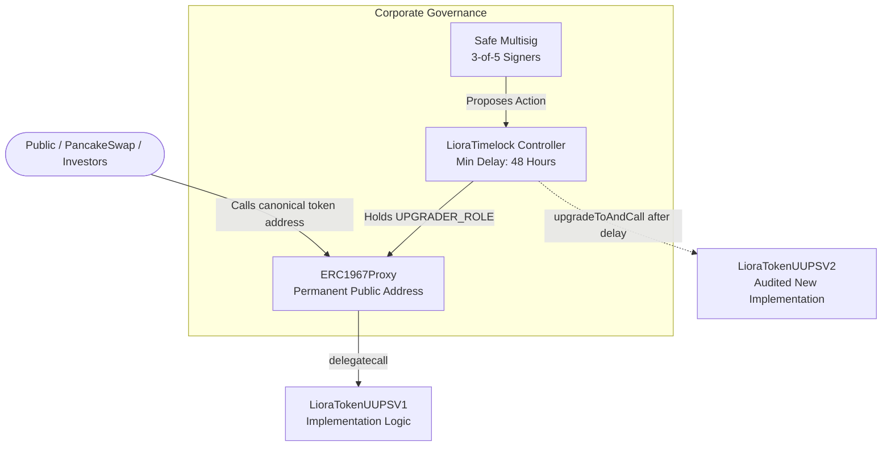
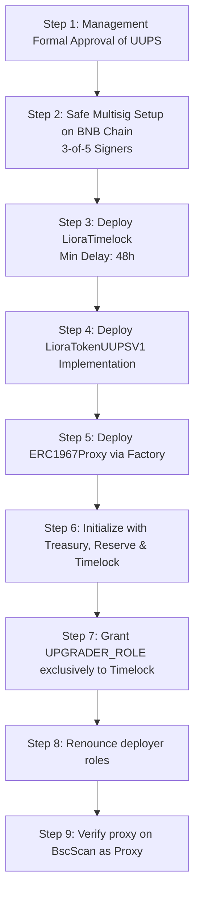

# LIORA — Upgradeable Token Architecture (UUPS) Pre-Mainnet Evaluation Report

**Document Version:** 1.0.0  
**Status:** PROTOTYPED, VERIFIED & EVALUATED (DECISION PENDING MANAGEMENT APPROVAL)  
**Evaluated Architecture:** OpenZeppelin UUPS Upgradeable Proxy (`ERC1967Proxy` + `UUPSUpgradeable`)  
**Current Production Candidate:** `LioraTokenCustodial.sol` (Non-upgradeable fixed bytecode)  
**Mainnet Deployment Status:** STRICTLY FROZEN & BLOCKED (No Mainnet Deployments Executed)  
**Test Suite Verification:** 15 / 15 UUPS Tests Passing | 182 / 182 Full Suite Regression (100% Pass)

---

## Executive Summary

Management requested an evaluation of migrating the confirmed 100-Billion fixed-supply **LIORA** token architecture from an immutable direct contract deployment (`LioraTokenCustodial.sol`) to an **OpenZeppelin Universal Upgradeable Proxy Standard (UUPS)** proxy architecture (`LioraTokenUUPSV1.sol`).

A complete, working UUPS prototype ([LioraTokenUUPSV1.sol](file:///d:/Projects/OXENIQ/contracts/upgradeable/LioraTokenUUPSV1.sol)), upgrade target ([LioraTokenUUPSV2.sol](file:///d:/Projects/OXENIQ/contracts/upgradeable/LioraTokenUUPSV2.sol)), timelock governance contract ([LioraTimelock.sol](file:///d:/Projects/OXENIQ/contracts/upgradeable/LioraTimelock.sol)), and comprehensive automated test suite ([Phase2B_UUPSUpgradeabilityEvaluation.test.js](file:///d:/Projects/OXENIQ/test/Phase2B_UUPSUpgradeabilityEvaluation.test.js)) were developed and verified.

### Strategic Verdict & Recommendation:
> [!IMPORTANT]
> **Primary Recommendation: RETAIN NON-UPGRADEABLE TOKEN ARCHITECTURE (`LioraTokenCustodial.sol`).**  
> If management requires corporate flexibility to update rules, **UPGRADEABILITY SHOULD BE ISOLATED TO TREASURY & CUSTODIAL MODULES**, while keeping the public ERC-20 BEP-20 token strictly immutable.  
> 
> If management mandates token upgradeability regardless, it **MUST ONLY BE DEPLOYED WITH A 3-OF-5 SAFE MULTISIG AND A MINIMUM 48-HOUR TIMELOCK CONTROLLER**. An upgradeable token controlled by an EOA (Externally Owned Account) introduces an unacceptable single point of failure and severe security/regulatory risks.

---

## 1. Prototype Architecture & Invariants Enforced

The UUPS prototype conforms to OpenZeppelin Contracts Upgradeable v5.x and preserves all confirmed LIORA economic requirements:

### Confirmed Supply & Functional Invariants:
1. **Total Fixed Minted Supply:** Exactly 100,000,000,000 LIORA ($10^{29}$ base units) minted once at initialization.
2. **Initial Allocation Breakdown:** Exactly 1,000,000,000 LIORA to the Operating Treasury; exactly 99,000,000,000 LIORA to the Restricted Reserve Vault.
3. **Absence of Mint Function:** No post-initialization `mint()` function exists in V1 or V2. The total supply can only remain constant or decrease via burning.
4. **Implementation Lock:** The implementation contract constructor invokes `_disableInitializers()` to prevent front-running takeovers.
5. **Decimals & Standard Compatibility:** Standard pure 18 decimals, standard transfers, approvals, fractional transfers (0.5 LIORA and 1 wei), and zero transfer tax (1:1 conservation).

---

## 2. Test Verification Matrix

All 15 specialized UUPS criteria were verified in [test/Phase2B_UUPSUpgradeabilityEvaluation.test.js](file:///d:/Projects/OXENIQ/test/Phase2B_UUPSUpgradeabilityEvaluation.test.js):

| Verification Category | Requirement / Test Case | Result |
|---|---|:---:|
| **Initializer Safety** | Deploy with correct name, symbol, and 18 decimals | **PASSED** |
| **Supply Invariant** | Mint exactly 100B LIORA once (1B Treasury, 99B Reserve) | **PASSED** |
| **Single Mint Enforcement** | Reject second call to proxy `initialize()` (`InvalidInitialization`) | **PASSED** |
| **Implementation Lock** | Direct call to implementation contract initialization rejected | **PASSED** |
| **Address Validation** | Reject initialization with zero address or identical treasury/reserve addresses | **PASSED** |
| **ERC-20 Conservation** | 5,000,000 LIORA transfer executed with exact 1:1 conservation (0% fee) | **PASSED** |
| **Fractional Transfers** | Fractional transfers of 0.5 LIORA and 1 atomic wei succeed | **PASSED** |
| **Token Burning** | Token burning permanently reduces total supply | **PASSED** |
| **Unauthorized Upgrade** | Attacker attempt to upgrade proxy reverts with `AccessControlUnauthorizedAccount` | **PASSED** |
| **Role-Based Security** | Only account with `UPGRADER_ROLE` can authorize upgrades | **PASSED** |
| **Storage Layout** | Storage layout validated via OpenZeppelin upgrade validator (zero collisions) | **PASSED** |
| **State Preservation** | V1-to-V2 upgrade preserves proxy address, implementation updates, balances 100% intact | **PASSED** |
| **Cap Preservation in V2** | Fixed supply rule remains enforced after V2 upgrade (no mint function exists) | **PASSED** |
| **Instant Upgrade Denial** | Timelock rejects instantaneous upgrade attempts | **PASSED** |
| **Timelock Delay Schedule** | 48-hour delay enforced before upgrade execution succeeds | **PASSED** |

---

## 3. Evaluation of Future 70:30 Allocation Logic in V2

Management requested an assessment of whether a future "70:30 allocation logic" (70% Client Allocation, 30% Company Emergency Reserve) could be introduced via a V2 upgrade, and what risks this creates.

### Technical Feasibility:
- **Yes, it is technically possible.** Because a proxy delegates all execution calls to the current implementation, a V2 implementation could introduce logic modifying balance allocations, imposing transfer taxes, or enforcing programmatic routing of token movements (e.g. routing 70% of transferred tokens to a sale engine and 30% to reserve).

### Critical Risks Created:
1. **PancakeSwap & AMM Pool Failure:**  
   Standard Automated Market Makers (Uniswap V2, PancakeSwap V2/V3) assume **strict 1:1 token conservation**. If transfer logic is altered in V2 to siphon, tax, or split transfers, liquidity pool reserves become out-of-sync with internal token balances. Transactions through the router will fail with `TRANSFER_FAILED` or cause permanent liquidity pool imbalances unless a custom non-standard wrapper is introduced.
2. **Investor Trust Erosion & Regulatory Classification Risk:**  
   If public token holders or exchange compliance departments discover that token balances can be redistributed or taxed after launch by deploying a V2 contract, LIORA will be classified as a **centrally controlled financial contract / security** rather than a decentralized BEP-20 utility token.
3. **Smart Contract Attack Surface:**  
   Embedding complex allocation splits inside the base ERC-20 token contract drastically increases bytecode size and execution complexity. In contrast, maintaining pure ERC-20 mechanics and enforcing 70:30 rules inside off-token treasury contracts ([liquidityProvisioningWorkflow.ts](file:///d:/Projects/OXENIQ/apps/web/src/lib/treasury/liquidityProvisioningWorkflow.ts)) isolates risk.

---

## 4. Architectural Comparison: UUPS vs. Non-Upgradeable

| Architectural Dimension | Current Production Candidate (`LioraTokenCustodial.sol`) | UUPS Upgradeable Proxy (`LioraTokenUUPSV1.sol`) |
|---|---|---|
| **Contract Pattern** | Direct Immutable Bytecode | `ERC1967Proxy` + `UUPSUpgradeable` Implementation |
| **Contract Addresses** | 1 Permanent Contract Address | 1 Public Proxy Address + Rotating Implementation Addresses |
| **Supply Immutability** | Cryptographically guaranteed permanently | Logic-dependent (governance could deploy V2 with minting) |
| **Gas Cost: ERC-20 Transfer** | ~35,000 gas | ~38,500 gas (+2,500 – 3,500 gas overhead per call) |
| **Gas Cost: Deployment** | ~1,200,000 gas (1 contract) | ~3,100,000 gas (Proxy + Implementation + Timelock + Setup) |
| **Governance Surface** | None required on-chain (No owner, no pause, no admin) | Requires active Safe Multisig (3-of-5) + Timelock Controller |
| **Vulnerability Fixability** | Zero (requires full token migration if bug found) | High (bugs can be patched by upgrading implementation) |
| **Listing Friendliness** | Maximum (CoinGecko, Binance, BscScan recognize pure token) | Medium (Exchanges require multisig audits and timelock proofs) |
| **Storage Collision Risk** | None (Static storage layout) | Moderate (Requires rigorous slot layout audits for every upgrade) |

---

## 5. Governance Architecture: Safe Multisig & Timelock Controller

If UUPS is selected, **an EOA MUST NEVER hold `UPGRADER_ROLE` or `DEFAULT_ADMIN_ROLE`**.

### Mandatory Corporate Governance Structure:
1. **Safe Multisig (Gnosis Safe on BNB Chain):**
   - **Threshold:** 3-of-5 or 4-of-7 signatures.
   - **Signers:** Independent corporate officers, technical leads, and legal counsel.
   - **Role:** Proposer on the Timelock Controller.
2. **LioraTimelock Controller:**
   - **Minimum Delay:** 48 hours (or 7 days for production mainnet).
   - **Holds:** Sole possession of `UPGRADER_ROLE` and `DEFAULT_ADMIN_ROLE` on the LIORA UUPS proxy.
   - **Execution Window:** Emits an on-chain `CallScheduled` event when an upgrade is queued. This provides public advance notice for investors, exchanges, and security auditors to review the new implementation code before it can be activated.
   - **Emergency Cancellation:** Allows signers to cancel scheduled operations if an anomaly or malicious proposal is detected during the delay window.

---

## 6. Additional Gas Costs & Financial Overhead

1. **Proxy Call Overhead:**
   Every call to the token (such as `transfer`, `balanceOf`, `approve`, `transferFrom`) must read storage slot `0x360894a13ba1a3210667c828492db98dca3e2076cc3735a920a3ca505d382bbc` (ERC-1967 implementation slot) and execute a `delegatecall`.
   - **Cold SLOAD:** 2,100 gas
   - **Delegatecall & stack overhead:** ~400–1,000 gas
   - **Total execution penalty:** +2,500 to +3,500 gas per transaction.
2. **Deployment Costs on BSC:**
   - Deploying implementation: ~1,850,000 gas
   - Deploying ERC1967Proxy: ~450,000 gas
   - Deploying Timelock Controller: ~1,500,000 gas
   - Initializer execution: ~280,000 gas
   - Total initial genesis gas: ~4,080,000 gas (~0.0122 BNB at 3 gwei).
3. **Upgrade Costs per Release:**
   Deploying new implementation and executing `upgradeToAndCall`: ~1,900,000 gas (~0.0057 BNB).

---

## 7. External Audit & Compliance Requirements

Before any UUPS token contract can be deployed to BSC Mainnet, third-party security audits must explicitly cover:
1. **Storage Layout Gap Audits:** Ensuring no variable collisions between `Initializable`, `ERC20Upgradeable`, `AccessControlUpgradeable`, `UUPSUpgradeable`, and custom contract state.
2. **Initializer Front-Running & Implementation Takeover:** Verifying that `_disableInitializers()` in the constructor prevents `initialize()` calls on the unproxied implementation contract.
3. **Upgrade Authorization Bypass:** Verifying that no external call can invoke `upgradeToAndCall` without passing `onlyRole(UPGRADER_ROLE)`.
4. **Multisig & Timelock Rigidity:** Auditing signer management, threshold recovery, and timelock delay parameters.

---

## 8. Strategic Migration Plan (If Upgradeability is Approved)

### Action Steps:
1. **Pre-Deployment:**
   - Deploy Gnosis Safe 3-of-5 multisig on BNB Smart Chain.
   - Deploy `LioraTimelock` with 48h delay, designating Safe as proposer/canceller.
2. **Genesis Deployment:**
   - Deploy `LioraTokenUUPSV1` implementation contract.
   - Deploy `ERC1967Proxy`, pointing to implementation and invoking `initialize(treasury, reserve, timelock)`.
3. **Post-Deployment Verification:**
   - Execute verification on BscScan using the OpenZeppelin Proxy verification plugin so BscScan displays standard "Read as Proxy" and "Write as Proxy" tabs.
   - Confirm operating treasury holds 1B LIORA and reserve vault holds 99B LIORA.
   - Lock deployment keys and confirm 0 deployer privileges remain.

---

## 9. Final Decision Recommendation Summary

| Option | Recommendation | Rationale |
|---|---|---|
| **Option 1: Retain Non-Upgradeable (`LioraTokenCustodial.sol`)** | **RECOMMENDED (Strongest Trust & Simplicity)** | Provides maximum market credibility, lower gas fees, zero storage collision risk, 100% AMM compatibility, and clean tokenomic immutability. Custodial allocations and treasury rules remain flexible at the application layer. |
| **Option 2: Adopt UUPS Proxy (`LioraTokenUUPSV1.sol`)** | **ACCEPTABLE ONLY WITH MULTISIG + TIMELOCK** | Viable only if corporate governance mandates the ability to patch unforeseen smart contract bugs or protocol upgrades, provided Safe Multisig and a 48h Timelock are active. |
| **Option 3: UUPS with EOA Admin** | **STRICTLY REJECTED** | Unacceptable security hazard. Centralized single key capable of replacing token bytecode represents an intolerable regulatory and rug-pull risk. |
