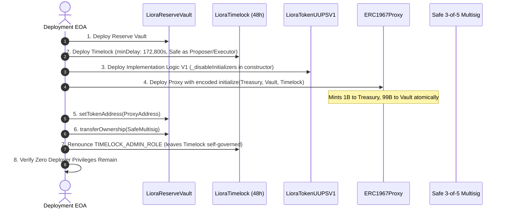

# LIORA — UUPS BSC Mainnet Deployment Checklist & Runbook

**Target Network:** BNB Smart Chain Mainnet (Chain ID 56)  
**Smart Contract Architecture:** OpenZeppelin UUPS Upgradeable Proxy  
**Current Gate Status:** **MAINNET DEPLOYMENT STRICTLY BLOCKED**  
**Required Sign-Offs:** Corporate Multisig Committee, Smart Contract Security Auditor, Legal & Compliance

---

## 1. Mainnet Pre-Deployment Requirements (Mandatory Gates)

Before running any deployment script against BSC Mainnet (Chain ID 56), the following prerequisite conditions must be completed and signed off:

- [ ] **1. Safe 3-of-5 Multisig Deployed on BSC Mainnet:**
  - Create a Safe multisig contract on BNB Smart Chain Mainnet (Chain ID 56).
  - Configure threshold: Exactly 3 confirmations required out of 5 designated owners.
  - Owners must be separate corporate executives and lead engineers using hardware wallets (Ledger/Trezor).
  - No single private key or hot wallet can authorize transactions.
- [ ] **2. Hardware Signers Verified:**
  - Ensure all 5 hardware wallets have confirmed access to their BSC Mainnet addresses and Safe web interface.
  - Document wallet public addresses in the internal governance registry.
- [ ] **3. External Smart Contract Security Audit:**
  - Deliver `contracts/upgradeable/` and `contracts/LioraReserveVault.sol` to external audit firm.
  - Receive formal audit report with zero High or Critical vulnerabilities.
  - Complete any required audit remediation passes.
- [ ] **4. Operating Treasury Wallet Designated:**
  - Secure corporate treasury account configured on BSC Mainnet.
  - Confirmed address for receiving the initial 1,000,000,000 LIORA operational allocation.
- [ ] **5. Gas Funding:**
  - Sufficient BNB funded to the deployment coordinator wallet for transaction fees only.

---

## 2. Mainnet Deployment Sequence (Step-by-Step Execution)



### Detailed Execution Protocol:

#### Step 1: Deploy `LioraReserveVault`
- Deploys vault contract holding 99,000,000,000 LIORA with multi-sig release restrictions.
- Initial owner set to deployer (temporarily for binding).

#### Step 2: Deploy `LioraTimelock`
- Parameters:
  - `minDelay`: `172,800` seconds (48 hours).
  - `proposers`: `[SAFE_MULTISIG_ADDRESS]`
  - `executors`: `[SAFE_MULTISIG_ADDRESS]`
  - `admin`: `DEPLOYER_ADDRESS` (temporary, renounced in Step 7).

#### Step 3: Deploy `LioraTokenUUPSV1`
- Deploys raw logic implementation.
- Constructor runs `_disableInitializers()` preventing implementation takeover.

#### Step 4: Deploy `ERC1967Proxy`
- Encodes call to `initialize(operatingTreasury, reserveVaultAddress, timelockAddress)`.
- Atomically executes `_mint(operatingTreasury, 1_000_000_000 * 10^18)` and `_mint(reserveVaultAddress, 99_000_000_000 * 10^18)`.
- Grants `DEFAULT_ADMIN_ROLE` and `UPGRADER_ROLE` directly to `LioraTimelock`.
- No admin privileges granted to deployer.

#### Step 5: Bind Reserve Vault to Proxy
- Execute `vault.setTokenAddress(proxyAddress)`.

#### Step 6: Transfer Reserve Vault Ownership to Safe Multisig
- Execute `vault.transferOwnership(SAFE_MULTISIG_ADDRESS)`.
- Deployer relinquishes all control over reserve releases.

#### Step 7: Renounce Timelock Administration
- Deployer calls `timelock.renounceRole(TIMELOCK_ADMIN_ROLE, deployerAddress)`.
- Only the Timelock contract itself holds administrative control over role management.

#### Step 8: Post-Deployment Verification
- Run verification script to confirm:
  1. `proxy.totalSupply() == 100_000_000_000 * 10^18`
  2. `proxy.balanceOf(operatingTreasury) == 1_000_000_000 * 10^18`
  3. `proxy.balanceOf(reserveVault) == 99_000_000_000 * 10^18`
  4. `proxy.hasRole(UPGRADER_ROLE, timelockAddress) == true`
  5. `proxy.hasRole(UPGRADER_ROLE, deployerAddress) == false`
  6. `proxy.hasRole(DEFAULT_ADMIN_ROLE, deployerAddress) == false`
  7. Deployer holds ZERO tokens and ZERO privileged roles.

---

## 3. BSCScan Source Code Verification

Verify all deployed contracts on BSCScan Mainnet:
```bash
npx hardhat verify --network bscMainnet <RESERVE_VAULT_ADDRESS>
npx hardhat verify --network bscMainnet <TIMELOCK_ADDRESS> 172800 '["<SAFE_MULTISIG>"]' '["<SAFE_MULTISIG>"]' '<DEPLOYER>'
npx hardhat verify --network bscMainnet <IMPLEMENTATION_V1_ADDRESS>
npx hardhat verify --network bscMainnet <PROXY_ADDRESS> <IMPLEMENTATION_V1_ADDRESS> <INITIALIZE_ENCODED_DATA>
```
On BSCScan, link the ERC1967 Proxy to the implementation using the **"Is this a proxy?"** tool to enable standard token information and contract tabs.

---

## 4. Active Mainnet Blockers

The following items represent hard blockers that prevent any mainnet deployment at this time:

1. **Corporate 3-of-5 Safe Multisig Address Not Provided:** Real hardware wallet addresses and Safe creation on BSC Mainnet must be completed by the security committee.
2. **Third-Party Security Audit Signoff:** Formal external security audit report must be approved by executive leadership.
3. **Liquidity & Custody Policy Alignment:** Legal compliance signoff on custodial allocation limits and manual payment verification SOP.

> [!CAUTION]
> Under NO CIRCUMSTANCES should any engineer run deployment scripts targeting BSC Mainnet (Chain ID 56) with temporary or personal private keys. The system fails closed.
